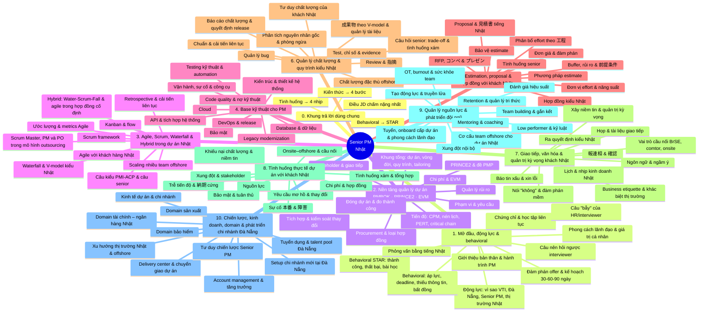

<!-- Mở bằng markmap (VS Code extension 'Markmap' hoặc markmap.js.org/repl) để xem dạng cây. Bản tương tác: mindmap.html -->

# Senior PM · IT outsourcing Nhật

## 0. Khung trả lời dùng chung
### Behavioral → STAR
- Situation · Task ngắn (20%)
- Action chiếm ~50% thời lượng
- Result có số + bài học
### Tình huống → 4 nhịp
- ① Xác nhận fact, phạm vi ảnh hưởng
- ② Hành động ngay, khoanh vùng
- ③ Báo khách: 報連相, bad news first
- ④ Gốc rễ + 再発防止 · 横展開
### Kiến thức → 4 bước
- Định nghĩa 1 câu
- Khi nào dùng / không dùng
- Ví dụ dự án khách Nhật
- Bẫy hay gặp
### Điều JD chấm nặng nhất
- Estimate + proposal tiếng Nhật
- Quy trình chất lượng Nhật
- Chịu trách nhiệm cao nhất với khách
- Build team & chi nhánh Đà Nẵng

## 1. Mở đầu, động lực & behavioral
### Giới thiệu bản thân & hành trình PM
- Pitch 60–90 giây: Hiện tại – Quá khứ – Tương lai
  - 150–220 chữ
  - kết bằng câu nối sang JD
- Dự án nổi bật kể STAR, thuộc 3 con số
  - team · man-month · kết quả
- Nói thật mức làm việc trực tiếp với khách Nhật
  - 定例会 (teireikai)
  - 報連相 (hou-ren-sou)
- Senior = phạm vi ảnh hưởng, không phải số năm
  - lãi lỗ · tình huống xám · người kế cận
- Đã "sống" trong nhiều mô hình hợp đồng
  - 請負 (ukeoi) · 準委任 (jun-inin) · ODC/Labo
### Động lực: vì sao VTI, Đà Nẵng, Senior PM, thị trường Nhật
- Ba lớp lý do: thị trường · khách hàng · hướng phát triển
  - chỉ dùng fact từ JD/trang chính thức
- Đà Nẵng: cam kết gắn bó 2–3 năm trở lên
  - lợi thế build-up chi nhánh
- Senior PM: tham gia estimate, proposal từ đầu
  - 見積もり (mitsumori) · 提案書 (teiansho)
- Mục tiêu 3–5 năm đo được, gắn với công ty
  - Delivery/Program Manager
- Không coi outsourcing là bước đệm sang sản phẩm
### Behavioral STAR: thành công, thất bại, bài học
- STAR + Learning, Action chiếm khoảng 60%
  - Result phải có số
- Thất bại: nhận phần mình sai, nói thay đổi đã làm
  - change request · Definition of Done
- Thay đổi team bằng thử nghiệm nhỏ có đo lường
  - 振り返り (furikaeri)
- Đóng góp cho tổ chức ngoài dự án
  - 横展開 (yokotenkai)
- Tách rõ việc của team và quyết định của mình
  - chịu được 3 lớp "vì sao"
### Behavioral: áp lực, deadline, thiếu thông tin, bất đồng
- Nhịp tình huống 4 bước
  - fact → khoanh vùng → 報連相 → 再発防止 / 横展開
- Deadline bất khả: số liệu + 2–3 phương án
  - giảm phạm vi · thêm người · giao từng phần
- Thiếu thông tin: đảo ngược được thì quyết nhanh
  - ghi giả định · điểm kiểm tra lại
- Bất đồng sếp: dữ liệu, trao đổi riêng trước
  - 根回し (nemawashi)
- Không che giấu lỗi với khách
  - báo fact sớm, đối sách sau
- Onsite đổ lỗi: nhìn số liệu, một tiếng nói với khách
### Phong cách lãnh đạo & giá trị cá nhân
- Servant leadership, đổi phong cách theo tình huống
  - situational leadership
- Điểm yếu thật → hậu quả → hành động → bằng chứng
- Trao quyền theo năng lực × mức rủi ro
  - kiểm soát điểm rủi ro, không kiểm soát người
- KPI bản thân 4 nhóm
  - tiến độ · chất lượng · effort · con người & khách
- Thành công = giá trị + lãi + khách quay lại + team khỏe
### Phỏng vấn bằng tiếng Nhật
- Khiêm nhường ngữ, nói kết luận trước
  - 敬語 (keigo) · 結論から (ketsuron kara) · 〜と申します
- Gọi công ty đúng ngữ cảnh
  - 御社 (onsha) khi nói · 貴社 (kisha) khi viết
- Trình độ tiếng Nhật: nói thật, nêu việc làm được
  - JLPT N〇 + họp, email, xác nhận spec bằng văn bản
- Kể thất bại có nhân–quả rõ
  - 〜ため · それ以降
- Luôn có câu hỏi ngược, không nói 特にありません
  - 伺ってもよろしいでしょうか
- Chưa hiểu thì xin nhắc lại hoặc xác nhận ý
  - 〜という理解でよろしいでしょうか
### Chứng chỉ & học tập liên tục
- Chứng chỉ = đã dùng để làm gì khác đi
- Chưa có chứng chỉ: thực hành tương đương + mốc thi
- Bộ đôi nền tảng + agile
  - PMP/PRINCE2 · PSM/CSM/PMI-ACP
- Cloud ở mức đủ ra quyết định
  - shared responsibility · Cloud Practitioner
- Dùng AI nhưng giữ bảo mật dữ liệu khách
### Câu "bẫy" của HR/interviewer
- Lý do nghỉ khớp lý do ứng tuyển
- Job hopping: luôn bàn giao xong dự án mới đi
- Lương: đưa khoảng, nhìn tổng gói
  - chênh 10–15% · thưởng dự án/doanh thu · review 2 lần/năm
- OT: có khi sự cố, kéo dài là lỗi kế hoạch
- Chuyển về Đà Nẵng: đưa bằng chứng ổn định
- Offer khác: trung thực, nói vì sao ưu tiên
### Câu nên hỏi ngược interviewer
- Dự án, giai đoạn, người ra quyết định phía khách
- Tiêu chí thành công sau 6 tháng
  - nguyên liệu cho kế hoạch 30-60-90
- Cơ cấu team Đà Nẵng và phối hợp onsite
- Quy trình chất lượng, chỉ số đang theo dõi
- Tránh hỏi lương, nghỉ phép ở vòng chuyên môn
- Chốt: "anh/chị còn băn khoăn gì về em?"
### Đàm phán offer & kế hoạch 30-60-90 ngày
- Đàm phán theo giá trị, nhìn tổng gói
  - mức tối thiểu đặt trước
- Thỏa thuận thêm phải ghi trong offer letter
  - review sau thử việc có tiêu chí + thời điểm
- 30 ngày: học, xây quan hệ, đo hiện trạng
  - bản đánh giá hiện trạng + top rủi ro
- 60 ngày: ổn định nhịp, 2–3 cải tiến lớn
- 90 ngày: tự chủ, có kết quả đo được
- Tự đề xuất tiêu chí thành công thử việc

## 2. Nền tảng quản lý dự án (PMBOK · PRINCE2 · EVM)
### Khung tổng: dự án, vòng đời, quy trình, tailoring
- Dự án tạm thời, duy nhất; vận hành lặp lại
  - 運用保守 (unyou hoshu) đo bằng SLA
- 5 process group lặp trong mỗi pha, không tuần tự
  - Initiating → Closing · M&C chạy suốt
- PMBOK 7: principles + performance domains, đo outcome
  - 12 principles · 8 domains · value
- Charter do sponsor ký, trao quyền cho PM
  - 前提条件 (zentei jouken) · 対象外 (taishougai)
- Tailoring: mức kiểm soát tương xứng rủi ro
- Outsourcing là matrix: chốt resource plan với line manager
  - % allocation · escalate có số liệu
### Tích hợp & kiểm soát thay đổi
- Integration = trade-off toàn cục, chỉ PM làm
- Baseline chỉ đổi khi CR được duyệt
  - scope + schedule + cost = PMB
- Quy trình CR 6 bước, CR từ chối vẫn lưu
  - change log · 工数 (kousuu) · 稟議 (ringi)
- CCB có ngưỡng phân quyền cho PM
  - ví dụ ≤ 2–3 man-day, không chạm milestone
- Configuration management giữ version nhất quán
  - 構成管理 (kousei kanri) · CI · audit trước 納品
- "Thay đổi nhỏ" vẫn ghi log, cộng dồn có ngưỡng
### Phạm vi & yêu cầu
- WBS theo quy tắc 100%, kể cả việc ẩn
  - PM · review · môi trường · migration · UAT
- Work package 8–80 giờ, có tiêu chí xong
  - WBS dictionary
- Scope statement ghi rõ loại trừ và giả định
  - 要件定義書 · 対象外 · 前提条件
- RTM nối yêu cầu → thiết kế → test → CR
- Scope creep (khách) vs gold plating (team)
- Validate (khách nhận) ≠ control (PM theo dõi) ≠ QC
### Tiến độ: CPM, nén lịch, PERT, critical chain
- CPM: forward/backward pass tìm critical path
  - TF = LS − ES · FF = ES sau − EF
- Float âm = kế hoạch không khả thi
  - luật Parkinson · student syndrome
- Crashing tốn tiền, fast-tracking tăng làm lại
  - chi phí/ngày = ΔCost/ΔTime · luật Brooks
- PERT ba điểm cho khoảng tin cậy
  - E = (O + 4M + P)/6 · σ = (P − O)/6
- Critical chain: buffer gom cuối chuỗi
  - project buffer · feeding buffer · fever chart
- Leveling đổi ngày kết thúc, smoothing chỉ dùng float
### Chi phí & EVM
- Cost baseline gồm contingency, không gồm MR
  - budget = baseline + MR · 予実管理 (yojitsu kanri)
- Chỉ số bắt đầu từ EV
  - CV = EV − AC · SV = EV − PV
  - CPI = EV/AC · SPI = EV/PV
- Dự báo bằng dải EAC, không một con số
  - BAC/CPI · AC + (BAC − EV) · AC + (BAC − EV)/(CPI×SPI)
- ETC, VAC, TCPI đo độ khả thi
  - ETC = EAC − AC · VAC = BAC − EAC · TCPI = (BAC − EV)/(BAC − AC)
- Đo EV khách quan tránh hội chứng 90%
  - 0/100 · 50/50 · 20/80 · weighted milestone
- SPI về 1 cuối dự án; FP dùng EVM bảo vệ margin
  - Earned Schedule · 原価 (genka) · S-curve
### Quản lý rủi ro
- Risk chưa xảy ra, issue đã xảy ra
  - 課題管理表 (kadai kanrihyou)
- Mô tả nguyên nhân – sự kiện – tác động
  - trigger · risk owner gần nguồn rủi ro
- Định tính cho mọi rủi ro, định lượng cho top
  - P × I · EMV = xác suất × tác động · decision tree
- Ứng phó rủi ro tiêu cực và cơ hội
  - avoid/transfer/mitigate/accept/escalate
  - exploit/enhance/share
- Residual (còn lại) vs secondary (mới sinh ra)
- Contingency → fallback; workaround khi không có kế hoạch
  - giả định sai = rủi ro
### Stakeholder & giao tiếp
- Power/interest grid ra chiến lược từng nhóm
  - 体制図 (taiseizu) · manage closely · keep satisfied
- Engagement matrix: hiện tại C vs mong muốn D
- RACI: mỗi việc đúng một A
- Kênh giao tiếp tăng gần theo bình phương
  - n(n − 1)/2 · 10→15 người: +60 kênh
- Status report: kết luận trước, tiêu chí màu rõ
  - 進捗報告 (shinchoku houkoku) · 議事録 (gijiroku)
- Tin xấu báo interactive trước, văn bản sau
  - 根回し (nemawashi) · Q&A表
### Procurement & loại hợp đồng
- FP: vendor gánh rủi ro chi phí; T&M: khách gánh
- Cost-reimbursable chia sẻ rủi ro bằng phí
  - CPFF · CPIF · CPAF
- FPIF tính theo target, share ratio, ceiling
- Make-or-buy xét năng lực lõi, IP, bảo mật
  - 再委託 (saiitaku) cần khách cho phép
- RFP: bám tiêu chí chấm, hỏi rõ trong hạn
  - RFI · RFQ · 提案依頼書 (teian iraisho)
- Subcontractor back-to-back, mình chịu trách nhiệm cuối
### Đóng dự án & đo thành công
- Đóng chính thức, kể cả dự án bị hủy
  - 検収 · 完了報告書 (kanryou houkokusho)
- Lessons learned thu suốt dự án, dùng lại
  - 横展開 (yokotenkai) · KPT · 振り返り (furikaeri)
- Thành công ngoài tam giác sắt
  - chất lượng · khách ký tiếp · margin · sức khỏe team
- Benefits realization đo sau go-live
  - business case · benefits management plan
- Chọn dự án: ưu tiên NPV, bỏ qua sunk cost
  - NPV · IRR · payback · opportunity cost
### PRINCE2 & đề PMP
- 7 principles, 7 themes, 7 processes
  - manage by stages · focus on products
- Management by exception theo tolerance
  - Highlight Report · Exception Report · Exception Plan
- Project Board: Executive, Senior User, Senior Supplier
- PRINCE2 cho quản trị, PMBOK cho kỹ thuật
- Logic đề PMP: phân tích tác động trước
  - change control · update register · đưa phương án cho sponsor
- Chứng chỉ là ngôn ngữ chung, không thay kinh nghiệm
  - PMP · PRINCE2 · PMI-ACP · PSM/CSM

## 3. Agile, Scrum, Waterfall & Hybrid trong dự án Nhật
### Waterfall & V-model kiểu Nhật
- Chuỗi 工程 tuần tự, mỗi bước có exit criteria
  - 要件定義 → 基本設計 → 詳細設計 → 製造
  - 単体 → 結合 → 総合 → 受入テスト
  - 成果物 phê duyệt · 指摘 đóng
- V-model: mỗi mức thiết kế ứng một mức test
  - test viewpoint lập ngay khi thiết kế
- 上流 vs 下流: muốn lên thượng nguồn phải giỏi hạ nguồn
  - BrSE · domain · tiếng Nhật
- 手戻り phát hiện càng muộn càng đắt
  - prototype · walkthrough · spike
- Chọn waterfall khi yêu cầu ổn định, đổi muộn đắt
  - core tài chính · 請負 phạm vi chốt
- Bug lọt: chốt ranh giới trách nhiệm từng 工程
  - 再発防止 · 横展開
### Scrum framework
- 3 accountabilities · 5 events · 3 artifacts
  - PO · SM · Developers
- Mỗi artifact có một commitment
  - Product Goal · Sprint Goal · DoD
- Timebox theo sprint 1 tháng
  - Planning 8h · Daily 15' · Review 4h · Retro 3h
- DoD là chuẩn chung, DoR chỉ là practice bổ sung
  - DoD ≠ AC
- Bẫy PSM thường gặp
  - chỉ PO hủy sprint · refinement không phải event · team ≤ 10
- Điểm mới Scrum Guide 2020
  - self-managing · true leaders who serve · bỏ 3 câu hỏi Daily
### Scrum Master, PM và PO trong mô hình outsourcing
- PM đứng tầng delivery, thương mại, ngoài Scrum Team
- PO phía khách chậm do 稟議, cần lịch cố định
  - SLA Q&A · refinement nhẹ
- Proxy PO sở hữu sự rõ ràng, không sở hữu ưu tiên
  - ma trận ủy quyền · log quyết định
- BrSE kiêm proxy PO được, kiêm SM nên hạn chế
- ラボ型 vs 請負 làm đổi cách phân vai
### Kanban & flow
- Trực quan hóa, giới hạn WIP, quản lý flow
  - stop starting, start finishing
- Lead time là khách thấy, cycle time là nội bộ
- Little's Law nối WIP, throughput, cycle time
  - Cycle time = WIP / Throughput
- Đọc CFD: dải phình là bottleneck
- Kanban hợp 保守運用 với classes of service
  - Expedite · Fixed date · Standard · Intangible
- Dự báo theo xác suất thay vì một ngày cứng
  - Monte Carlo · work item age · SLA
### Ước lượng & metrics Agile
- Story point tương đối, không quy đổi giờ từng story
  - 人月 ở cấp release
- Planning poker để lộ khác biệt hiểu biết
  - tránh anchoring · tách item ≥ 13
- Velocity chỉ để team tự lập kế hoạch
  - không so team · định luật Goodhart
- Burnup lộ scope creep, dùng để đàm phán phạm vi
- Predictability ổn định quan trọng hơn tốc độ
  - 80–100% (tham khảo)
- Team mới: dự báo từ capacity, thu hẹp sau 3 sprint
  - cone of uncertainty
### Hybrid: Water-Scrum-Fall & agile trong hợp đồng cố định
- Water-Scrum-Fall ổn khi có chủ đích và feedback giữa chừng
- Cố định giá và ngày, linh hoạt phạm vi
  - MoSCoW · đổi item cùng kích thước
- 請負 vs 準委任 khi chạy agile
  - mẫu hợp đồng agile của IPA theo 準委任
- Release nhỏ = nhiều lần tập nghiệm thu
- Tài liệu just-in-time, đi trước dev 1 sprint
- Hai track nhanh/chậm tách nhau qua contract
  - API contract · mock/stub
### Agile với khách hàng Nhật
- Hiểu nỗi lo trước khi thuyết phục
  - 合意形成 · 稟議 · tài liệu
- Bán kết quả bằng pilot nhỏ và số liệu
  - 反復型開発
- Sprint Review: gửi trước, demo theo nghiệp vụ, có biên bản
  - 結論から · 完了/未完了 · 議事録
- Khách im lặng không có nghĩa là đồng ý
  - feedback sau họp · câu hỏi A/B
- Duyệt thay đổi theo lô kèm SLA
- Giúp người phụ trách "dịch" agile cho cấp trên
  - burnup ↔ WBS · 根回し · 見通し
### Scaling nhiều team offshore
- Scrum of Scrums đủ cho 2–4 team
- SAFe đồng bộ nhiều team bằng ART và PI Planning
  - 50–125 người · PI 8–12 tuần · RTE
- LeSS: một PO, một backlog, một sprint chung
- Scale nhẹ nhất, giảm dependency trước
  - feature team · enabling team
- Nhiều site dùng chung khung tối thiểu
  - DoD · nhịp sprint · báo cáo khách
### Retrospective & cải tiến liên tục
- Khung 5 bước, mở đầu bằng review action cũ
- KPT là format nhìn lại phổ biến ở Nhật
  - Keep · Problem · Try · 振り返り
- Action ít, cụ thể, có owner, vào Sprint Backlog
- An toàn tâm lý cho team ít nói
  - Prime Directive · sticky ẩn danh · dot-voting
- Retro là vòng 改善, sự cố dùng なぜなぜ分析
  - PDCA
- Đo retro bằng action xong và vấn đề lặp lại
### Câu kiểu PMI-ACP & câu senior
- Manifesto: vế phải vẫn có giá trị
- Nhận diện fake agile, sửa 1–2 điểm hại nhất
- Đo value bằng chỉ số nghiệp vụ của khách
  - WSJF · value–effort
- Servant leadership vẫn phải quyết khi cần
  - true leaders who serve
- Mẹo ACP: chọn team cùng quyết và minh bạch
- Biết khi agile là sai, chuyển đổi có đường lui
  - pilot · tiêu chí sau 3 sprint · 90 ngày

## 4. Base kỹ thuật cho PM
### Kiến trúc & thiết kế hệ thống
- Hiểu đủ để hỏi đúng và chọn trade-off
  - 方式設計
  - 3 rủi ro kỹ thuật lớn nhất
- Mặc định modular monolith, microservices cần lý do thật
  - scale khác nhau · release độc lập
  - ADR ghi cái giá
- Batch phải xong trong batch window, rerun không trùng
  - 夜間バッチ · ジョブネット · JP1
  - dư ≥ 30% window (tham khảo)
- NFR chốt bằng con số + điều kiện đo
  - 非機能要件 · 非機能要求グレード (IPA)
  - 99.9% ≈ 8,8 giờ/năm · 99.99% ≈ 52 phút/năm
- Bất đồng kỹ thuật: cùng khung so sánh, PoC, ADR
### API & tích hợp hệ thống
- Contract-first: OpenAPI là baseline, đổi có version
  - mock server · v1/v2 song song
- Ủy quyền khác xác thực
  - OAuth2 · OIDC · SSO/SAML · IdP
- File interface: bẫy bảng mã tính theo byte
  - 固定長 · Shift_JIS/UTF-8/EBCDIC
  - 全角 · 外字 · 和暦
- Chống trùng và chống lan lỗi
  - idempotency key · timeout/retry/backoff · dead-letter queue
- Môi trường đối tác là mốc phụ thuộc trong kế hoạch
  - ma trận interface · stub/mock · 報連相
- Challenge estimate bằng checklist câu hỏi kỹ thuật
### Database & dữ liệu
- RDBMS cho tiền/hợp đồng, NoSQL cho key/scale
  - ACID · eventual consistency
- Chậm: xem execution plan trước khi mua phần cứng
  - index · N+1 · partition/archive
- Migration là dự án con từ ngày đầu
  - データ移行 · profiling dữ liệu
- Rehearsal 2–3 lần, đối soát nhiều tầng
  - 移行リハーサル · số bản ghi/tổng tiền/mẫu/báo cáo
- Rollback phải diễn tập, schema đổi kiểu expand–contract
  - 切り戻し · Go/No-Go có giờ
- Không đưa dữ liệu thật về offshore
  - giả lập → mask → test tại môi trường khách
### Cloud
- Càng lên SaaS càng ít vận hành, càng phụ thuộc
  - IaaS/PaaS/SaaS · 運用保守
  - shared responsibility
- Dịch vụ lõi AWS để đọc sơ đồ, đọc hóa đơn
  - EC2 · S3 · RDS · Lambda (≤ 15 phút) · VPC · IAM
- FinOps: ước tính, tag, alert, review hằng tháng
  - Pricing Calculator · budget alert · NAT Gateway/log
- DR theo RPO/RTO khách chọn theo chi phí
  - Multi-AZ · Tokyo + Osaka
- Khách tài chính ưa on-prem: hiểu lý do trước khi thuyết phục
  - 閉域網 · chủ quyền dữ liệu · lộ trình hệ thống không lõi
- Lock-in chấp nhận có ý thức, ghi chi phí thoát
### DevOps & release
- Quy tắc nhánh quan trọng hơn mô hình nhánh
  - GitFlow vs trunk-based · デグレ
- CI/CD và IaC đưa vào sprint 0
  - 構成管理 · Terraform/CloudFormation
- Chọn Kubernetes chỉ khi có người vận hành
- Môi trường tách bạch, quyền 本番 tối thiểu
  - dev · 検証環境 · 本番
- Tiêu chí rollback chốt trước release
  - 本番リリース手順書 · blue-green/canary · feature flag
- Đo pipeline theo ngữ cảnh release của khách
  - DORA
### Testing kỹ thuật & automation
- Tự động hóa đáy tháp, test tay cho nghiệp vụ
  - UT/IT/ST/UAT · 単体テスト · 受入テスト
- Coverage là cờ báo, không phải KPI
  - C0/C1 · assertion
- Test hiệu năng sớm, theo NFR đã chốt
  - performance/load/stress · JMeter/k6/Gatling
- ROI automation tính bằng ngày công
  - (tiết kiệm − viết − bảo trì) / đầu tư
- Hồi quy theo rủi ro, test data là task có owner
  - 影響調査 · smoke + luồng chính
### Bảo mật
- OWASP vào quy trình, không chỉ vào slide
  - Broken Access Control · SAST · dependency scan
- Secret không nằm trong code; lộ là revoke ngay
  - secret manager · pre-commit scan
- Least privilege, quyền 本番 tạm thời có log
  - bastion/VPN · rà quyền hằng tháng
- Vendor là bên nhận ủy thác, khách phải giám sát
  - 個人情報保護法 (APPI) · FISC 安全対策基準
- ISMS thể hiện ở vận hành hằng ngày
  - phòng dev riêng · khóa USB · audit
- Sự cố lộ code: báo sớm, không che giấu
  - 報連相 · 再発防止 · 横展開
### Legacy modernization
- Nhu cầu modernization lớn từ cảnh báo 2025
  - 2025年の崖 · DX Report METI 2018
- Mainframe: rủi ro tài liệu lệch code, thiếu người
  - ホスト系 · COBOL/JCL · CRUD matrix
- Chọn chiến lược theo từng hệ thống
  - rehost · replatform · refactor · rebuild
- "Giữ như cũ" phải chốt tiêu chí so sánh
  - 現行踏襲 · cùng input so output
- Giảm rủi ro cutover bằng chạy song song, chuyển dần
  - 並行稼働 · strangler fig vs big-bang
- Assessment trước, cam kết sau
### Code quality & nợ kỹ thuật
- Review PR nhỏ, máy lo hình thức
  - ソースレビュー · コーディング規約 · linter
- Quality Gate áp cho code mới
  - SonarQube · code smell
- Nợ kỹ thuật phải đo được mới xin được trả
  - 技術的負債 · thời gian thay đổi · số lần デグレ
- Trả nợ bằng capacity cố định, minh bạch phần lỗi vendor
  - 10–20% sprint (tham khảo)
- Tiếp quản: báo cáo hiện trạng có số liệu tháng đầu
- Theo dõi EOL, đề xuất trước 6–12 tháng
  - năm tài chính bắt đầu tháng 4
### Vận hành, sự cố & công cụ
- Log, monitoring, alert có người nhận trước go-live
  - correlation ID · mask dữ liệu
- SLA lỏng hơn SLO, dùng error budget để quyết release
  - SLI · SLO · SLA
- RCA đi đến tầng quy trình, không đổ lỗi cá nhân
  - timeline · 暫定対応 · 恒久対応
- Dùng công cụ khách chọn, một nguồn sự thật
  - Redmine · Backlog · Excel WBS · 課題管理表
- GenAI: đo trong dự án, xin phép bằng văn bản
  - gói doanh nghiệp · guideline · chặn công cụ cá nhân
- Giữ base kỹ thuật bằng thói quen có lịch
  - đọc PR/ADR · lab AWS · chứng chỉ

## 5. Estimation, proposal & hợp đồng với khách Nhật
### Đơn vị effort & năng suất
- Chốt quy đổi giờ với khách từ đầu
  - 1人日 = 8h · 1人月 = 20人日 = 160h (tham khảo)
  - ghi vào điều kiện báo giá
- Effort ≠ thời gian: thêm người không rút lịch tuyến tính
  - Brooks's law
  - kênh giao tiếp n(n−1)/2
- Tách effort, duration, cost; tách theo vai trò
  - 工数 · 体制
  - PM / BrSE / dev / QA / comtor
- Offshore: đơn giá thấp nhưng có overhead cầu nối
  - Q&A, dịch, review chéo
- Lịch nghỉ hai nước và người mới đổi lịch, không đổi effort
  - Tết · GW · お盆 · năm tài chính tháng 3
  - ramp-up 50–70% tháng đầu (tham khảo)
### Phương pháp estimate
- Chọn theo giai đoạn, luôn kiểm chéo 2 cách
  - analogous → parametric → WBS bottom-up
  - lệch > 20% thì tìm nguyên nhân
- FP đo chức năng, độc lập ngôn ngữ
  - IFPUG: ILF · EIF · EI · EO · EQ
  - đếm nhanh kiểu NESMA cho 概算
- 3-point/PERT lộ độ bất định
  - E = (O + 4M + P)/6
  - σ ≈ (P − O)/6
- Delphi ẩn danh lộ giả định ngầm
  - Wideband Delphi · expert judgment
- Dữ liệu lịch sử cùng định nghĩa đơn vị
  - actual + % lệch + nguyên nhân
- Phi chức năng phải có checklist riêng
  - 非機能要件 · 非機能要求グレード (IPA)
### Phân bổ effort theo 工程
- Tỷ lệ tham khảo để lọc bất hợp lý
  - 要件定義 10–15% · 製造・単体 25–35%
  - 結合 ~15% · 総合 10–15%
- Ghi rõ ranh giới công đoạn vendor nhận
  - 詳細設計 → 結合テスト (phổ biến)
  - hỗ trợ 受入テスト tính dòng riêng
- Overhead tính bottom-up rồi so %
  - PM 10–15% · QA 10–20% · BrSE 10–20% (tham khảo)
- Tài liệu tiếng Nhật, Q&A, evidence là effort thật
  - 設計書 · QA表 · エビデンス
- Chi phí ngoài nhân công và bảo trì
  - 支給 · 保守運用 · SLA
### Buffer, rủi ro & 前提条件
- Contingency gắn rủi ro có tên, không cộng % mù
  - known vs unknown unknowns
  - 10–15% / 20–30% (tham khảo)
- 前提条件 kiểm chứng được = căn cứ 追加見積
  - có ngày, số, phiên bản tài liệu
- 対象外 liệt kê cụ thể
  - migration · UAT · vận hành · license
- 概算 là range, có hạn hiệu lực
  - 概算見積 vs 詳細見積 · 有効期限 · 稟議
- Chia giai đoạn để giảm bất định
  - 多段階見積 · mẫu hợp đồng METI/IPA
- Rủi ro ngoài kiểm soát → điều khoản
  - 変更管理 · tỷ giá · đầu vào của khách
### Bảo vệ estimate
- Giảm giá thì phải giảm việc
  - phạm vi · điều kiện · loại hợp đồng · lịch
- Cone of uncertainty giải thích vì sao cần range
  - 0.25x–4x → 0.67x–1.5x (McConnell)
- Estimate ≠ target ≠ commitment
  - P80 cho 請負 · tách estimate và price
- So đối thủ trên cùng phạm vi
  - 見積根拠 · cùng 前提条件/対象外
- Chống bias bằng quy trình
  - anchoring · planning fallacy · checklist
### Proposal & 見積書 tiếng Nhật
- Đi từ vấn đề khách đến giải pháp
  - 背景・課題 → 提案概要 → 対応範囲 → 体制図 → 見積
- 1 slide 1 message
  - メッセージライン · 体言止め
- Chất lượng tiếng Nhật kiểm bằng quy trình
  - 表記ゆれ · 用語集 · font Nhật
- Cho khách lựa chọn, dễ trình duyệt nội bộ
  - 松竹梅 · 稟議
- 見積書 khớp từng yên với 提案書
  - 単価 · 納期 · 支払条件 · 備考
- 実績 ẩn danh theo NDA
  - 大手保険会社様
### RFP, コンペ & プレゼン
- Go/No-Go trước khi viết proposal
  - năng lực · độ rõ yêu cầu · khả năng thắng
- Q&A kèm giả định đề xuất
  - 〜と想定していますが
- Thắng bằng giảm rủi ro, không phá giá
  - 評価基準 · POC · 実績 cùng ngành
- Không cam kết tại chỗ
  - 持ち帰って検討 · trả lời đúng hạn
- POC có tiêu chí và nên tính phí
  - 概念実証 · 準委任 · timebox
- Thua thì học
  - 失注理由
### Hợp đồng kiểu Nhật
- 請負 cam kết kết quả, 準委任 cam kết công sức
  - 成果物 · 善管注意義務
  - 履行割合型 vs 成果完成型
- Quyền chỉ huy luôn ở vendor
  - 派遣 · 指揮命令 · 偽装請負
- Mô hình team dài hạn
  - ラボ型開発 · SES · 精算幅 140–180h
- 検収 có tiêu chí và hạn
  - 検収書 · みなし検収 · 分割検収
- Trách nhiệm sau giao từ luật 2020
  - 契約不適合責任 · 追完 · thỏa thuận hạn
- Khung pháp lý và bảo mật
  - 基本契約 + 個別契約 · 著作権 · NDA
### Đơn giá & đàm phán
- Đơn giá từ chi phí thật
  - chi phí ÷ utilization + rủi ro + margin
  - bench cost
- Discount phải đổi lấy điều kiện
  - volume · cam kết dài hạn
- Yên yếu: chia sẻ rủi ro, không chỉ giảm giá
  - cơ cấu nhân sự · điều khoản tỷ giá
- Thay đổi có quy trình
  - 仕様変更 · 追加見積 · bug vs thay đổi
- Hợp đồng phải khớp vận hành
  - 一括請負 · đơn giá × số lượng · margin forecast
### Tình huống senior
- Migration: kiểm kê trước, test so sánh là phần đắt
  - 棚卸し · 現新比較
- AI: chia phần cam kết được và không
  - 努力目標 · PoC 準委任
- Không spec thì không ký 請負 trọn gói
  - 要件定義 準委任 trước
- Lỗ do estimate sai: nhận trách nhiệm, sửa quy trình
  - 報連相 · 再発防止 · 横展開
- Team mới: dự án đầu là nguồn dữ liệu
  - hệ số ramp-up · pilot

## 6. Quản lý chất lượng & quy trình kiểu Nhật
### Tư duy chất lượng của khách Nhật
- Chất lượng là niềm tin: sản phẩm, quy trình, giải trình
  - 品質 (hinshitsu) · 信頼 (shinrai)
- Zero defect nghĩa là không để lỗi lọt sang khách
  - 流出 (ryuushutsu)
  - Mục tiêu: 0 lỗi nghiêm trọng lọt ra
- Kế hoạch chất lượng là luật chơi chung, khách duyệt
  - 品質計画書
  - Mục tiêu định lượng + mức evidence
- Quality gate cuối mỗi công đoạn
  - 工程完了判定 · tiêu chí vào/ra
- Đo 手戻り để thấy chi phí bị rò
  - Giờ 手戻り / tổng giờ công
  - Tách 手戻り do mình và do khách
- Minh bạch sớm tạo an tâm cho khách
  - 安心感 · QCD
  - 品質は工程で作り込む
### 成果物 theo V-model & quản lý tài liệu
- Bộ deliverable chuẩn, phân vai tạo và duyệt
  - 要件定義書 → 基本設計書 → 詳細設計書
  - テスト仕様書 · テスト結果報告書 · 運用手順書
- Chốt mức chi tiết bằng mẫu một chức năng
  - Tiêu chí: người khác đọc là code/test được
- Version rõ ràng, thay đổi được đánh dấu
  - 改訂履歴
  - Excel 方眼紙: khó diff, cần owner theo file
- Tài liệu trước, code sau
  - Ma trận truy vết yêu cầu ↔ thiết kế ↔ test
- Ký duyệt là chuỗi trách nhiệm
  - 作成 → 確認 → 承認
  - Không 承認 khi thiếu biên bản review
### Review & 指摘
- Review nhiều tầng, bắt lỗi ở tầng thấp nhất
  - セルフ → ピア → 有識者 → 顧客レビュー
  - Walkthrough · inspection
- Biên bản review vừa để đo vừa là evidence
  - レビュー記録票
- Phân loại 指摘 để thấy lỗi bản chất
  - 誤り · 漏れ · 曖昧 · 不整合 · 表記
- Mật độ chỉ ra so với baseline nội bộ
  - 指摘密度 = 指摘 / trang hoặc KLOC
  - Đọc kèm レビュー工数密度
  - Lệch trên → 差し戻し
- 0 指摘 là tín hiệu nghi ngờ, không phải thành tích
  - Review lấy mẫu bổ sung
- Review sản phẩm, không review người
### Test, chỉ số & evidence
- Mỗi mức test bắt một loại lỗi riêng
  - 単体 · 結合 · 総合 · 受入テスト
  - Coverage C0/C1
- Bao phủ quan điểm quan trọng hơn số case
  - テスト観点 · 観点の網羅
- Mật độ test và mật độ bug phải đọc cùng nhau
  - テスト密度 = case / KLOC hoặc FP
  - バグ密度 = bug / KLOC hoặc FP
  - Ma trận 2×2 theo module
- Đường cong bug phải hội tụ trước release
  - 信頼度成長曲線 · 収束 · Gompertz
  - Đi ngang sớm → nghi test thiếu; bậc thang → デグレ
- Không evidence coi như chưa test
  - エビデンス: screenshot, log, DB trước/sau
  - Thỏa thuận mức evidence · masking dữ liệu cá nhân
- Tiêu chí bắt đầu/kết thúc thống nhất trước
  - 開始基準 · 完了基準 · 消化率 100%
### Quản lý bug
- Phiếu bug đủ trường phân tích mới được đóng
  - 不具合管理票 · 起票
- Severity khác priority, định nghĩa có ví dụ
  - 重要度 vs 優先度
  - S1: dừng hệ thống, sai tiền/dữ liệu, bảo mật
- Phân loại nguyên nhân để biết sửa quy trình ở đâu
  - 仕様漏れ · 設計ミス · 実装ミス · テスト漏れ
  - Thêm loại "nguyên nhân phía khách"
- Ma trận công đoạn gây lỗi × công đoạn phát hiện
  - 作り込み工程 × 摘出工程 · 見逃し
  - 工程内摘出率
- Reopen cao là sửa chưa triệt để
  - 影響調査 · 再テスト
- Bug khách tìm thấy được ưu tiên, thống kê riêng
### Phân tích nguyên nhân gốc & phòng ngừa
- なぜなぜ dựa trên fact, dừng ở cơ chế
  - Đọc ngược "vì vậy" để kiểm logic
  - 三現主義: 現場 · 現物 · 現実
- Không lấy lỗi con người làm nguyên nhân gốc
  - 注意不足 · 確認不足
  - Biện pháp "気をつけます" bị trả lại
- Phân tích cả nguyên nhân phát sinh lẫn nguyên nhân lọt
  - 発生原因 · 流出原因
- Biện pháp là cơ chế, có owner, đo được hiệu quả
  - 再発防止策 · 仕組み · ポカヨケ
- Chặn thiệt hại trước, xử lý tận gốc sau
  - 暫定対応 → 恒久対応
- Nhân rộng kiểm tra sang chỗ tương tự
  - 横展開: kiểm N chỗ, sửa M chỗ, có evidence
### Báo cáo chất lượng & quyết định release
- Báo cáo chất lượng gồm định lượng, định tính, đánh giá
  - 品質報告書 · 定量 · 定性
  - 評価: kết luận đạt/chưa đạt và vì sao
- Báo cáo sự cố đủ mục chuẩn
  - 障害報告書: 発生日時 · 影響範囲 · 原因
  - 暫定 · 恒久 · 再発防止 · 横展開
- Báo sự cố nhiều lần, lần đầu thật nhanh
  - 第一報 → 続報 → 最終報
- Phạm vi ảnh hưởng phải có số và căn cứ
- Release dựa trên mức sẵn sàng toàn diện
  - 出荷判定 / リリース判定 · 出荷判定会議
  - 条件付き出荷: khách đồng ý bằng văn bản
- Tin xấu: sự thật → nguyên nhân → hành động → dự báo
### Chuẩn & cải tiến liên tục
- ISO là tín hiệu quy trình, không thay chất lượng thật
  - ISO 9001 (QMS) · 内部監査 · 是正処置
  - ISO 27001 (ISMS): phân quyền, thiết bị, dữ liệu
- CMMI 5 mức, mức 4 quản lý bằng số liệu
  - Initial → Managed → Defined → Quantitatively Managed → Optimizing
- PDCA: đừng bỏ chữ A
- Cải tiến nhỏ, liên tục, do người làm đề xuất
  - 改善 · 改善提案
  - 5S: 整理 · 整頓 · 清掃 · 清潔 · 躾
- Pareto, xương cá, phân tầng là công cụ chính
  - QC七つ道具 · パレート図 · 特性要因図
- Tailoring quy trình để tránh "làm giấy tờ"
### Chất lượng đặc thù offshore
- Lỗi offshore chủ yếu do hiểu sai spec
  - Nhiều tầng truyền tin · giả định ngầm
- Hỏi đáp có sổ, câu hỏi kèm phương án
  - Q&A管理表
- Xác nhận hiểu đúng trước khi code
  - Giải thích ngược · 認識合わせ
- Checklist ngắn, sinh ra từ lỗi thật
  - Kiểm tra lấy mẫu · tự động hóa mục kiểm được
- Self-check và kiểm chéo trước bàn giao
  - 納品 · 納品物一覧 · build từ source sạch
- Tài liệu tiếng Nhật sạch lỗi, BrSE là cổng chất lượng
  - 誤字脱字 · 表記ゆれ · glossary
### Câu hỏi senior: trade-off & tình huống xám
- Chỉ số đẹp mà khách chê: đo theo góc nhìn khách
- Bug density thấp bất thường: kiểm tra trước khi khen
  - Test thiếu? Không ghi phiếu? KLOC phình?
- Chất lượng – tiến độ – chi phí: trình phương án, khách quyết
  - Thu hẹp phạm vi · release có điều kiện · lùi ngày
  - Không thương lượng: tiền, dữ liệu, bảo mật
- Agile vẫn giữ tinh thần chất lượng Nhật
  - DoD chặt · test hồi quy tự động
- Văn hóa chất lượng team mới: ít quy tắc mà chắc
  - Template từ dự án thành công · baseline từ tuần đầu
- Chỉ số không dùng để chấm điểm người
  - Tách phân tích nguyên nhân khỏi đàm phán chi phí

## 7. Giao tiếp, văn hóa & quản trị kỳ vọng khách Nhật
### 報連相 & 確認
- Báo cả khi không có gì mới
  - im lặng = tin xấu
  - 予定通り · 一次回答
- Kết luận trước, tách fact và nhận định
  - 結論から
  - 事実 / 意見
  - con số thay "sắp xong"
- Báo sớm khi lệch, kèm kế hoạch phục hồi
  - lệch > 1 ngày ở milestone (tham khảo)
  - 中間報告 ở 30–50%
- Chủ động đi trước một bước
  - 先手 vs 後手
- Xác nhận 3 lớp: nhắc lại, văn bản, ví dụ
  - 復唱 · 念のため確認
  - 認識合わせ ở điểm chuyển giai đoạn
- Đúng liều, đúng kênh
  - 1 đầu mối gửi · nhãn 【至急】【共有】
  - tin xấu: gọi trước, email sau
### Ra quyết định kiểu Nhật
- Vận động trước họp chính thức
  - 根回し
  - tránh 「持ち帰ります」
- Trình ký nhiều cấp có lead time
  - 稟議 · 稟議書
  - đưa thời gian duyệt vào kế hoạch
- Giao tiếp theo cấp, giữ thể diện 担当
  - 担当 / 課長 / 部長
  - 決裁者
- Một đầu mối, chỉ PM cam kết
  - 窓口 chính + dự phòng
- Giúp khách quyết: phương án, hạn, chi phí chờ
  - 合意形成 · 期限
  - 暫定案 · tài liệu 担当 dùng lại được
### Họp & tài liệu giao tiếp
- Họp định kỳ có agenda trước 1 ngày
  - 定例会議
  - 決定事項 · 宿題
- Biên bản trong 24h, xin confirm
  - 議事録 · vendor chủ động viết
- Tách câu hỏi và vấn đề, có owner + hạn
  - QA管理表 · 課題管理表
  - câu hỏi kèm phương án đề xuất
- Báo cáo tiến độ: tóm tắt trước, màu có tiêu chí
  - 進捗報告書
  - 青 / 黄 / 赤 · 対策
- Minh bạch theo lớp
  - 見える化 · dashboard chung
  - 用語集
### Vai trò cầu nối BrSE, comtor, onsite
- BrSE lo hiểu đúng, comtor lo dịch
  - BrSE · コミュニケーター · onsite coordinator
- PM giữ quyết định và cam kết
  - tóm tắt song ngữ · chỉ PM xác nhận lịch/chi phí
- Chống BrSE thành nút cổ chai
  - capacity dịch ≤ 70–80% (tham khảo)
  - BrSE dự phòng · Q&A qua bảng
- Một giọng nói onsite–offshore
  - sync hằng ngày · thống nhất tin xấu trước
- Dịch máy: rủi ro bảo mật và sai nghĩa
  - NDA · công cụ được duyệt
### Ngôn ngữ & ngầm ý
- Keigo: tôn kính khách, khiêm nhường mình
  - 尊敬語 · 謙譲語 · 丁寧語
  - 御社 (nói) / 貴社 (viết) / 弊社
- Email chuẩn: mở – kết luận – kết
  - お世話になっております
  - ご確認のほどよろしくお願いいたします
  - 1 email 1 chủ đề
- Người Nhật nói "không" gián tiếp
  - それはちょっと · 難しいです
  - 検討します ≠ đồng ý
- Mơ hồ → hỏi đóng, ví dụ, chốt văn bản
  - 曖昧 · よしなに · 前向きに検討
- Đọc để phát hiện, hỏi để xác nhận
  - 空気を読む · 本音 / 建前
  - 相槌 ≠ đồng ý
### Báo tin xấu & xin lỗi
- Tin xấu báo sớm, kèm đối sách
  - 事象 · 影響範囲
  - 暫定対策 / 恒久対策
- Báo đầu tiên nhanh hơn đầy đủ
  - 第一報 30–60 phút (tham khảo)
  - 障害報告書 làm sau
- Xin lỗi = trách nhiệm + đối sách + phòng ngừa
  - お詫び · 再発防止策 · 横展開
- Không đổ lỗi member hay khách
  - 弊社の確認不足 · timeline fact
- Kênh xin lỗi tương xứng tác động
  - email / gọi / gặp mặt
  - lãnh đạo khi vượt quyền PM
- Tránh "dự án dưa hấu"
  - tiêu chí màu đo được · chuyển 黄 sớm
### Nói "không" & đàm phán mềm
- Không từ chối tại chỗ, hẹn phương án
  - trả lời lại trong 1–2 ngày
- Luôn kèm phương án thay thế
  - 代替案: CR · đổi chỗ · chia phase
- Từ chối lịch sự bằng keigo
  - いたしかねます · あいにく
  - tránh 無理です
- Làm miễn phí phải hiển thị giá trị
  - サービス · danh sách hỗ trợ ngoại lệ
- Thỏa hiệp có đổi lại, giữ thể diện
  - 落とし所 · không phản bác 部長 công khai
- Nói không dứt khoát khi phạm luật, bảo mật
### Lịch & nhịp kinh doanh Nhật
- Năm tài chính phổ biến 4 → 3
  - 年度 · 上期 / 下期
- Tháng 3 cao điểm, tháng 4 đổi người
  - 年度末 · 人事異動
- Kỳ nghỉ dài, khách vắng
  - Golden Week · お盆 · 年末年始
- Tết VN rơi đúng mùa bận của khách
  - báo sớm · trực luân phiên
- Lệch 2 tiếng, chọn khung họp chung
  - 10–12 / 15–17 giờ JP
  - báo cáo ngày trước 15:00 giờ VN
- Tránh release sát kỳ nghỉ
### Xây niềm tin & quản trị kỳ vọng
- Niềm tin = lời hứa nhỏ được giữ
  - 信頼関係 · 約束を守る
- Cam kết thực tế, buffer minh bạch
  - under-promise over-deliver · 10–15% (tham khảo)
- Không giữ được thì báo trước hạn
  - 期限前の相談 · không trễ 2 lần
- Chỉnh cách làm theo loại khách
  - khách mới vs 慣れ · 改善提案
  - 情報システム部 vs business user
- Đo khoảng cách kỳ vọng sớm
  - demo định kỳ · khảo sát mỗi phase
  - lời khen có thể là 建前
### Business etiquette & khác biệt thị trường
- Trao danh thiếp đúng nghi thức
  - 名刺交換 · hai tay · 頂戴いたします
- Thăm khách: đúng giờ, đúng chỗ ngồi
  - lễ tân 5 phút trước · 上座 / 下座
- Trang phục bảo thủ theo ngành
  - vest tối màu · クールビズ
- Tiệc và quà theo compliance khách
  - 飲み会 · 接待 · 無礼講
  - お土産 個包装
- Nhật vs Hàn vs Singapore
  - đồng thuận · tốc độ · hợp đồng/KPI

## 8. Tình huống thực tế dự án với khách Nhật
### Trễ tiến độ & 納期 cứng
- Báo sớm kèm phương án, không đợi cạn buffer
  - 報連相
  - lệch > 2 ngày → escalate
- Giữ 納期 bằng chia đợt, không cắt chất lượng ngầm
  - 段階リリース
  - must-have vs làm sau
- Đầu vào trễ: định lượng ảnh hưởng, ghi văn bản
  - 課題管理表
  - お客様作業
  - 前提条件
- Báo cáo bằng chỉ số khách quan, không tô xanh
  - burndown / EVM
  - tiêu chí "vàng" định lượng
- Mốc cứng cần rehearsal và điểm go/no-go
  - 移行
  - 切り戻し
### Sự cố 本番 & 障害
- Báo đầu tiên trước, nguyên nhân sau
  - 第一報
  - cập nhật theo mốc giờ
- Khoanh vùng trước, sửa gốc sau
  - 暫定対応 → 恒久対応
  - 影響範囲
- Chỉ làm trong thẩm quyền đã thỏa thuận
  - runbook đã duyệt
  - ngoại lệ có phê duyệt văn bản
- Phòng ngừa là cơ chế, không phải nhắc nhở
  - なぜなぜ分析
  - 再発防止 · 横展開
- Bẫy đặc thù hệ thống Nhật
  - 外字 / Shift_JIS
  - đóng băng release quanh 年度末
### Yêu cầu mơ hồ & thay đổi
- Thay đổi sau khi chốt đều qua CR có estimate
  - 仕様変更
  - impact analysis 2–3 ngày
- Đưa về tài liệu, không cãi đúng sai trong họp
  - 当然
  - 議事録 · QA表
- Chặn scope creep bằng số liệu từ sớm
  - 請負
  - định nghĩa "chỉnh nhỏ" đo được
- Yêu cầu qua chat phải xác nhận bằng văn bản
  - 窓口
  - ticket hóa
- Câu hỏi đóng + hạn quyết định để gỡ mơ hồ
  - 検討します
  - tìm người quyết định thật
- "Giống hệ cũ" phải thành tài liệu kiểm chứng
  - 現行踏襲
  - reverse engineering có phí
### Khiếu nại chất lượng & niềm tin
- Nhận trách nhiệm trước, phân loại lỗi sau
  - 指摘
  - bảng đối chiếu sửa
- Tài liệu giải trình giúp 担当者 trình nội bộ
  - なぜなぜ分析 nộp nháp trước
- Minh bạch bằng chỉ số và bằng chứng
  - エビデンス
  - bug density thống nhất cách đếm
- Đe dọa đổi vendor → kéo cấp trên vào cuộc
  - 品質改善計画
  - mốc 30/60 ngày
- Kiểm soát của khách: nhận trước, giảm dần bằng dữ liệu
  - review theo rủi ro
### Onsite–offshore & cầu nối
- Trước khách là một công ty, truy lỗi trong nội bộ
  - 認識合わせ
- Không tin "わかりました", thiết kế bước xác nhận
  - 復唱
  - ví dụ input/output
- Rủi ro ngôn ngữ nằm ở từ điều kiện
  - 以上/超 · 以下/未満
  - glossary dịch bắt buộc
- Yêu cầu nhận ở onsite vào ticket trong 24 giờ
  - PM xem backlog hằng ngày
- Vai trò cầu nối luôn có người backup
  - 引継ぎ
  - 体制図 · RACI
### Nguồn lực
- Báo khách khi đã có phương án thay người
  - 体制
  - mỗi module ≥ 2 người hiểu sâu
- Ramp-up theo đợt, người cũ kèm người mới
  - onboarding kit
  - review 100% tháng đầu
- Thay người theo dữ liệu, giữ thể diện member
- Giảm người thì khách phải chọn cạnh tam giác
  - scope – thời gian – chi phí
- Không hứa điều mình không kiểm soát được
  - điều khoản báo trước + overlap
- Lịch nghỉ hai nước đưa vào WBS từ đầu
  - Tết ~ お正月
  - 年度末 · Golden Week · お盆
### Chi phí & hợp đồng
- Vượt effort: báo nội bộ ngay, tách phần có căn cứ
  - EAC
  - 見積 · ngưỡng lệch 10%
- Đòi phí CR bằng bằng chứng từng hạng mục
  - nhượng vùng xám, giữ phần rõ
- Loại hợp đồng phải khớp độ rõ yêu cầu
  - 準委任 vs 請負
  - 契約不適合責任
- 前提条件 là lá chắn của báo giá
  - スコープ外
  - báo giá 2 bước
- Nghiệm thu cần tiêu chí đo được
  - 検収 · 残課題
- Giá dưới vốn: đủ số liệu, không giảm chất lượng
  - ngưỡng dừng lỗ
### Xung đột & stakeholder
- Không phân xử nội bộ khách, đưa dữ liệu cho người quyết
  - RACI phía khách
- Giữ 窓口 ở trung tâm, không vượt mặt
- Họp nóng: tiếp nhận, xin lỗi, hẹn mốc
- 担当者 mới: hồ sơ quyết định + giúp họ thắng sớm
  - 引継ぎ
- Quyết định chậm: phục vụ quy trình phê duyệt của khách
  - 稟議
- Một tiếng nói nội bộ trước khi gặp khách
  - bàn giao sales → delivery
### Bảo mật & tuân thủ
- Rò rỉ: khoanh vùng, báo sớm, không giấu
  - 第一報
  - rotate secret
- Thu hồi kèm bằng chứng xóa/khóa
  - MDM
  - xác nhận xóa bằng văn bản
- Chính sách AI và dữ liệu test rõ ràng
  - tool được phép
  - masking
- Quyền truy cập theo vòng đời nhân sự
  - offboarding trong ngày
  - review quyền hằng tháng
- Trả lời audit/checklist trung thực, có kế hoạch khắc phục
  - 是正処置
- Kiểm license OSS trước khi dùng
  - GPL · scan trong CI
### Tình huống xám & tổng hợp
- Không sửa số, nhưng giúp khách diễn giải
- Trung thực với khách là giới hạn cứng
  - escalate PMO
- Lỗi sai tiền/dữ liệu/bảo mật thì không giao
  - 既知不具合一覧
  - khách quyết với đủ thông tin
- Ưu tiên: vận hành khách > hợp đồng > nội bộ
- Tiếp nhận 炎上: tự kiểm thực trạng trước khi hứa
  - 再計画
  - quick win lấy lại niềm tin
- Bảo vệ thông tin khách khác, chủ động báo lỗi tiềm ẩn
  - NDA

## 9. Quản lý nguồn lực & phát triển đội ngũ
### Cơ cấu team offshore cho dự án Nhật
- Vai trò rõ, chốt bằng RACI ngay kick-off
  - PM · BrSE · Tech Lead · QA/QC · Comtor
  - mỗi hoạt động đúng 1 A
- Tỉ lệ tham khảo, chỉnh theo số liệu dự án
  - BrSE:Dev 1:5–8
  - QA:Dev 1:3–5
- Span of control 6–8, vượt thì chia sub-team
  - leader sub-team · daily ≤ 15 phút
- Đa dự án: phân bổ theo rủi ro, không chia đều
  - dashboard chung · member tối đa 2 dự án
- Ramp-up theo phase, không đổ người sớm
  - resource histogram · QA vào trước test 2–3 tuần
- Tech Lead quyết cách làm, PM quyết phạm vi–thời gian–chi phí
  - ma trận quyền · 要件定義 cần BrSE
### Team building & gắn kết
- Tuckman: đi từ chỉ dẫn sang ủy quyền
  - Forming → Storming → Norming → Performing → Adjourning
- Luật chơi do team tự đặt
  - working agreement < 10 điều
- Nghi thức có mục đích
  - daily · demo · 振り返り · ăn mừng milestone
- Psychological safety là nền của báo cáo sớm
  - blameless · 報連相
- Đa địa điểm: một nguồn thông tin, ghép cặp xuyên site
  - HN–ĐN–onsite · luân chuyển onsite
- Kết thúc dự án: tổng kết và ghi nhận
  - 横展開 · cảm ơn gửi cả line manager
### Tạo động lực & truyền lửa
- Tiền là nền, động lực nội tại là động cơ
  - Herzberg · Pink: autonomy–mastery–purpose
- Giao kết quả + ràng buộc, không giao từng bước
  - lệch > 1 ngày phải báo
- Ghi nhận kịp thời, cụ thể, công khai đúng mức
- Maintain nhàm: mục tiêu cải tiến đo được, xoay vai
  - 改善 · 10–15% thời gian refactor
- Dự án đỏ: nói thật, mốc nhỏ thắng được, bảo vệ team
- Đo tinh thần bằng xu hướng
  - pulse survey · giảm 2 kỳ liên tiếp = trigger
### Mentoring & coaching
- 1-on-1 là buổi của member
  - 30 phút / 2 tuần · không hỏi tiến độ
- IDP gắn chu kỳ review 6 tháng
  - 70-20-10 · đào tạo tiếng Nhật, thi Cloud/AWS/PMP
- Coaching bằng câu hỏi, mentoring khi chưa có nền
  - GROW: Goal–Reality–Options–Will
- Đào tạo người kế cận BrSE và sub-leader
  - shadow → làm có duyệt → tự phụ trách
  - 確認 · JLPT N2
- Biến 指示待ち thành chủ động
  - giải thích "vì sao" · mang vấn đề kèm đề xuất
- Chia sẻ kiến thức vào tiêu chí đánh giá
  - 属人化 · review chéo · pair
### Đánh giá hiệu suất
- Không bất ngờ: nhật ký hiệu suất hằng tháng
  - tự đánh giá · 360° · check-in giữa kỳ
- KPI 3–5 mỗi vai + định tính 30–40%
  - Dev: đúng hạn, mật độ bug
  - QA: bug lọt · BrSE: Q&A hiểu sai
- KPI để đánh giá, OKR để thay đổi
- Tránh bias bằng bằng chứng và calibration
  - recency · halo/horn · leniency · similar-to-me
- Feedback khó theo SBI
  - Situation–Behavior–Impact
- Thưởng dự án theo tiêu chí công bố trước
### Low performer & kỷ luật
- Chẩn đoán trước khi xử lý
  - năng lực · động lực · hoàn cảnh
- PIP để giúp đạt, không phải thủ tục
  - 2–4 mục tiêu đo được · 1–3 tháng · cùng HR
- Chuyển vai trò trước khi cho rời
- Toxic high performer: hành vi cũng là hiệu suất
- Sự cố do member: khắc phục trước, blameless sau
  - 再発防止 · 横展開
- Cho nghỉ việc: PM cấp bằng chứng, HR xử lý
  - quy chế công ty · Bộ luật Lao động
### Xung đột nội bộ
- Chọn phong cách theo tình huống
  - Thomas–Kilmann: Competing · Collaborating · Compromising · Avoiding · Accommodating
- Bug hay spec: quay về nguồn, BrSE hỏi khách
  - 設計書 · bug triage
- Dev–QA cùng mục tiêu không lọt bug
  - KPI chung · QA vào từ review yêu cầu
- Hai site đổ lỗi: dùng dữ liệu và cơ chế
  - owner tích hợp · contract API · CI hằng ngày
- PM làm trọng tài khi tắc việc hoặc chạm cam kết
  - disagree and commit
### OT, burnout & sức khỏe team
- OT là triệu chứng, cần kế hoạch và số đo
  - cảnh báo > 20 giờ/tháng · Bộ luật Lao động
- Phát hiện burnout từ dữ liệu + 1-on-1
  - bug tăng bất thường · commit nửa đêm
- 年度末 trùng Tết: capacity plan từ quý trước
- Quyền từ chối OT, kế hoạch không dựa vào OT
- PM là lớp đệm: yêu cầu gấp đi qua một kênh
- Phục hồi sau nước rút
  - nghỉ bù · sprint nhẹ · retro nguyên nhân OT
### Retention & quản lý tri thức
- Người ta rời quản lý, không chỉ rời công ty
- Stay interview phòng ngừa, exit interview tìm xu hướng
- Counter offer chỉ khi lý do thật là tiền
  - tiền lệ · bất công nội bộ
- Mỗi module quan trọng ≥ 2 người tự làm được
  - bus factor · skill matrix · 属人化
- Bàn giao có reverse shadowing
  - 引き継ぎ · 引き継ぎ書
- Tài liệu "sống" nằm trong Definition of Done
### Tuyển, onboard cấp dự án & phong cách lãnh đạo
- Tuyển dev: cẩn thận và 報連相 hơn tốc độ
- Tuyển BrSE: test tìm điểm mơ hồ trong spec
- Onboarding 2 tuần: buddy, task tăng dần
- Ủy quyền: giao việc phải giao quyền
  - 4 mức ủy quyền · việc không ủy quyền
- Situational leadership theo người và theo việc
  - Directing · Coaching · Supporting · Delegating
- Servant leadership + quyết đoán khi khủng hoảng
  - dual career ladder

## 10. Chiến lược, kinh doanh, domain & phát triển chi nhánh Đà Nẵng
### Setup chi nhánh mới tại Đà Nẵng
- Lộ trình 0→30→100→300 theo gate, không theo ngày
  - billable ≥ 75–80% (tham khảo)
  - pipeline 1–2 quý
  - vị trí chủ chốt có người dự phòng
- Bảo mật site đạt chuẩn trước dự án đầu
  - セキュリティチェックシート
  - ISO/IEC 27001 mở rộng phạm vi
  - VDI · phòng dev riêng · 体制図
- Kế thừa chuẩn HQ, tự chủ cách triển khai
  - "cùng chuẩn, khác cách triển khai"
- Dự án mồi: vừa, rủi ro thấp, kể lại được
  - 5–10 người · 3–6 tháng (tham khảo)
- Thoát phụ thuộc HQ có lộ trình
  - ma trận HQ làm → ĐN học → ĐN làm
- Tăng đột biến: ramp-up theo đợt, giữ tỉ lệ senior
  - 報連相
### Tuyển dụng & talent pool Đà Nẵng
- Ba nguồn: trường, người tại ĐN, người về quê
  - ĐH Bách khoa ĐN · ĐH Duy Tân · ĐH FPT ĐN · VKU
  - referral
- Khác biệt bằng dự án và lộ trình, không chỉ lương
  - đào tạo tiếng Nhật
  - hỗ trợ thi Cloud/AWS/PMP
  - review 2 lần/năm
- Fresher ba luồng: kỹ thuật, quy trình Nhật, tiếng Nhật
  - 基本設計
  - shadow 1–2 tháng
- BrSE là nút thắt, cần lộ trình dự bị
  - ブリッジSE
  - N3 trở lên
- Đo tuyển dụng bằng chất lượng hơn tốc độ
  - time-to-fill
  - % qua thử việc
  - attrition 12 tháng đầu
- Kim tự tháp nhân sự có kiểm soát
  - senior : middle : junior ≈ 1 : 2 : 3 (tham khảo)
### Delivery center & chuyển giao dự án
- Chuyển giao bốn pha có exit criteria
  - 引継ぎ
  - KT → shadowing → reverse shadowing
  - tự xử lý ≥ 80% task (tham khảo)
- Trấn an khách bằng kế hoạch và số liệu
  - 安心
  - chuyển phần rủi ro thấp trước
- Phân bổ dự án theo năng lực, rủi ro, chiến lược
- Chuẩn hóa process liên site
  - template chung · audit chéo
- Mở rộng → trọn module → trọn dự án
  - tránh chia theo layer
- Mỗi mảng kiến thức có ít nhất hai người
  - bus factor ≥ 2
  - 再発防止
### Kinh tế dự án & chi nhánh
- P&L dự án và gross margin
  - GM = (doanh thu − chi phí trực tiếp) / doanh thu
- Utilization khác billable rate
  - billable 80–85% (tham khảo)
  - 100% không phải tốt
- Bench: phòng, dùng, giới hạn
  - bench 5–10% headcount (tham khảo)
- Chi phí ẩn ăn margin
  - BrSE/comtor · onsite
  - rework · chờ Q&A
- Margin thấp chỉ khi có lý do chiến lược
  - điều kiện thoát · giới hạn lỗ
- Thưởng doanh thu không đổi bằng chất lượng
  - 横展開 bài học dự án lỗ
### Account management & tăng trưởng
- Mở rộng account dựa trên niềm tin tích lũy
  - 信頼
  - maintain → tính năng → hệ thống mới → DX
- Upsell tăng quy mô, cross-sell thêm dịch vụ
- Chuyển sang đội dài hạn khi việc liên tục
  - 準委任 → ラボ型
- Đo hài lòng: khảo sát, chỉ số, hành vi
  - NPS = %(9–10) − %(0–6)
  - 問題ない chưa chắc là hài lòng
- POC chốt tiêu chí thành công trước
  - 2–6 tuần (tham khảo)
- Từ vendor thành partner bằng upstream
  - 要件定義
  - account plan · 稟議 · 挨拶
### Domain tài chính – ngân hàng Nhật
- Ba khối hệ thống ngân hàng
  - 勘定系 · 情報系 · 対外系
- Batch đêm có cửa sổ cố định
  - 夜間バッチ
  - rerun · thứ tự job
- Bảo thủ vì giám sát và giá sự cố
  - 金融庁 (FSA)
  - FISC安全対策基準
- Migration: đối soát, rehearsal, go/no-go
  - COBOL · chạy song song
- Dữ liệu thật không ra offshore
  - mask · quyền tối thiểu
  - không dán vào GenAI
- Offshore bắt đầu từ 情報系 và hệ thống vệ tinh
### Domain bảo hiểm
- Nhân thọ dài hạn, phi nhân thọ ngắn hạn
  - 生命保険 · 損害保険
  - 第三分野
- Chuỗi nghiệp vụ lõi bảo hiểm
  - 引受 · 契約管理 / 保全
  - 保険料計算
  - 保険金支払
- Kiểm thử số liệu: biên, làm tròn, so cũ–mới
  - アクチュアリー
- Legacy: điều tra ảnh hưởng trước mọi thay đổi
  - 影響調査
- Chứng từ in chính xác từng ký tự
  - 帳票
  - 和暦 (令和)
- Số hóa kênh bán theo bước nhỏ có chỉ số
### Domain sản xuất
- 生産管理/ERP lập kế hoạch, MES điều hành xưởng
  - MRP · traceability
- SAP: offshore làm interface, migration, test
  - ECC → S/4HANA · mốc cuối 2027
- TPS định hình kỳ vọng với vendor
  - トヨタ生産方式 · 自働化
  - 見える化 · カイゼン
  - なぜなぜ分析 · 現地現物
- Nói bằng chỉ số sản xuất, không bằng tính năng
  - QCD
  - OEE = khả dụng × hiệu suất × chất lượng
- Tôn trọng hiện trường, thử một dây chuyền trước
  - 現場
  - 品質管理
- AI kiểm ngoại quan ưu tiên tỉ lệ bỏ sót
### Xu hướng thị trường Nhật & offshore
- Vách đá 2025 → hiện đại hóa legacy
  - 2025年の崖
  - 経済産業省 (METI) 2018
  - ~12 nghìn tỷ yên/năm
- Nhật thiếu kỹ sư → đội dài hạn, upstream
- DX có ba mức
  - デジタイゼーション
  - デジタライゼーション
  - DX
- GenAI: đo năng suất trước khi hứa giảm giá
  - chính sách dùng AI được khách duyệt
  - review code do AI sinh
- Yên yếu ép margin → đa thị trường, giá trị cao
  - Hàn · Singapore
- Khách chuyển từ giá rẻ sang năng lực
  - cloud · bảo mật · chứng chỉ
### Tư duy chiến lược Senior PM
- Đóng góp ngoài dự án phải đo được
  - process · pre-sales
  - đào tạo · tài sản tái sử dụng
- Tầm nhìn 3 năm: tin cậy, tự chủ, trung tâm năng lực
- Sản phẩm riêng từ phần lặp lại, tôn trọng IP khách
  - kiểm tra điều khoản sở hữu trí tuệ
- Thẻ điểm cân bằng bốn nhóm
  - khách hàng · tài chính
  - delivery · con người
- Đặt "sàn" dài hạn khi đánh đổi ngắn hạn
- Leader tầng giữa quyết định thành bại chi nhánh
  - PM · tech lead · BrSE

---

## Toàn cảnh (mermaid)

