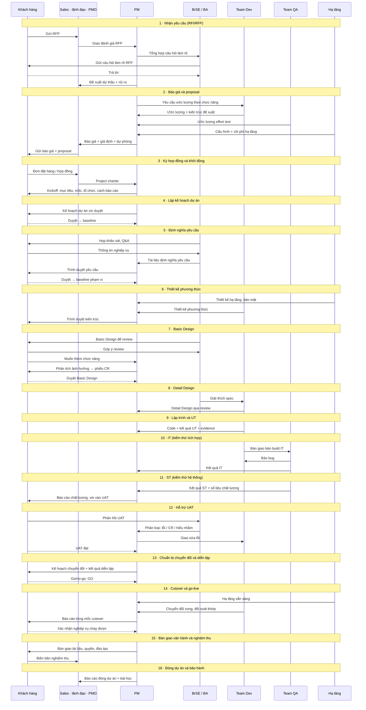

# Quy trình chuẩn dự án Waterfall cho khách Nhật · từ nhận yêu cầu đến đóng dự án

> 16 giai đoạn, xếp theo 5 nhóm quy trình PMP (Khởi tạo · Lập kế hoạch · Thực hiện · Giám sát & kiểm soát · Kết thúc). Mỗi giai đoạn có: đầu vào, **đầu ra của từng team**, **vai trò PM**, **gate** (tiêu chí + người duyệt) và bẫy hay gặp. Ngưỡng ghi "(tham khảo)" là mức kinh nghiệm; dự án thật theo kế hoạch đã thống nhất với khách.
>
> Bản tương tác (bấm từng giai đoạn, bảng đầu ra theo team, sơ đồ ai gửi gì cho ai): `on-tap-1000-tinh-huong.html`, tab **Sơ đồ quy trình chuẩn**. Tình huống luyện theo từng giai đoạn: [chương 9](chuong/chuong-09.md).

**7 team:** **Khách hàng** (phòng IT + phòng nghiệp vụ của khách) · **Sales · lãnh đạo · PMO** (bên nhận dự án: sales, ban giám đốc, PMO, đảm bảo chất lượng quy trình) · **PM** (quản lý dự án) · **BrSE / BA** (cầu nối với khách, phân tích nghiệp vụ, tài liệu bản tiếng Nhật) · **Team Dev** (tech lead + lập trình viên) · **Team QA** (kiểm thử) · **Hạ tầng** (máy chủ, mạng, bảo mật, môi trường)

## 1. Luồng tổng (flowchart)

```mermaid
flowchart TD
  subgraph S_ini["Khởi tạo"]
    direction TB
    P1["1 · Nhận yêu cầu (RFI/RFP)"]
    P2["2 · Báo giá và proposal"]
    P3["3 · Ký hợp đồng và khởi động"]
  end
  subgraph S_pln["Lập kế hoạch"]
    direction TB
    P4["4 · Lập kế hoạch dự án"]
  end
  subgraph S_exe["Thực hiện"]
    direction TB
    P5["5 · Định nghĩa yêu cầu"]
    P6["6 · Thiết kế phương thức"]
    P7["7 · Basic Design"]
    P8["8 · Detail Design"]
    P9["9 · Lập trình và UT"]
    P10["10 · IT (kiểm thử tích hợp)"]
    P11["11 · ST (kiểm thử hệ thống)"]
    P12["12 · Hỗ trợ UAT"]
    P13["13 · Chuẩn bị chuyển đổi và diễn tập"]
    P14["14 · Cutover và go-live"]
  end
  subgraph S_clo["Kết thúc"]
    direction TB
    P15["15 · Bàn giao vận hành và nghiệm thu"]
    P16["16 · Đóng dự án và bảo hành"]
  end
  P1 --> G1{{"◆ Quyết định dự thầu<br/>duyệt: Lãnh đạo + sales"}}
  G1 --> P2
  P2 --> G2{{"◆ Duyệt báo giá nội bộ<br/>duyệt: Lãnh đạo / PMO"}}
  G2 --> P3
  P3 --> G3{{"◆ Kickoff xong<br/>duyệt: Lãnh đạo + khách"}}
  G3 --> P4
  P4 --> G4{{"◆ Khách duyệt kế hoạch dự án<br/>duyệt: Khách + PMO"}}
  G4 --> P5
  P5 --> G5{{"◆ Khách duyệt định nghĩa yêu cầu<br/>duyệt: Khách (phòng IT + nghiệp vụ)"}}
  G5 --> P6
  P6 --> G6{{"◆ Duyệt thiết kế phương thức<br/>duyệt: Khách (phòng IT, an ninh thông tin)"}}
  G6 --> P7
  P7 --> G7{{"◆ Khách duyệt Basic Design<br/>duyệt: Khách"}}
  G7 --> P8
  P8 --> G8{{"◆ Review Detail Design nội bộ đạt<br/>duyệt: Nội bộ (PM, tech lead, đảm bảo chất lượng)"}}
  G8 --> P9
  P9 --> G9{{"◆ Xong lập trình + UT<br/>duyệt: Nội bộ"}}
  G9 --> P10
  P10 --> G10{{"◆ IT đạt<br/>duyệt: Nội bộ"}}
  G10 --> P11
  P11 --> G11{{"◆ Khách đồng ý bắt đầu UAT<br/>duyệt: Khách"}}
  G11 --> P12
  P12 --> G12{{"◆ UAT đạt<br/>duyệt: Khách"}}
  G12 --> P13
  P13 --> G13{{"◆ Họp go/no-go<br/>duyệt: Khách + lãnh đạo hai bên"}}
  G13 --> P14
  P14 --> G14{{"◆ Go-live thành công<br/>duyệt: Khách"}}
  G14 --> P15
  P15 --> G15{{"◆ Nghiệm thu<br/>duyệt: Khách"}}
  G15 --> P16
  P16 --> G16{{"◆ Đóng dự án<br/>duyệt: Lãnh đạo / PMO"}}
  MC["Giám sát & kiểm soát xuyên suốt:<br/>báo cáo tuần · họp định kỳ · Q&A · issue · rủi ro · CR · EVM · số liệu chất lượng"]
  MC -.-> P5
  MC -.-> P14
  classDef ini fill:#ccfbf1,stroke:#0f766e,color:#18212f
  class P1,P2,P3 ini
  classDef pln fill:#dbeafe,stroke:#24508f,color:#18212f
  class P4 pln
  classDef exe fill:#ecfccb,stroke:#4d7c0f,color:#18212f
  class P5,P6,P7,P8,P9,P10,P11,P12,P13,P14 exe
  classDef clo fill:#ede9fe,stroke:#7c3aed,color:#18212f
  class P15,P16 clo
  classDef gate fill:#fef3c7,stroke:#b45309,color:#18212f
  class G1,G2,G3,G4,G5,G6,G7,G8,G9,G10,G11,G12,G13,G14,G15,G16 gate
  classDef mc fill:#ffedd5,stroke:#b45309,stroke-dasharray:4 3,color:#18212f
  class MC mc
```

## 2. Ai gửi gì cho ai (sequence)

## 3. Bảng tóm tắt: PM làm gì, gate nào, ai duyệt

| # | Giai đoạn | Nhóm PMP | Việc chính của PM | Gate ◆ | Người duyệt |
| --- | --- | --- | --- | --- | --- |
| 1 | [Nhận yêu cầu (RFI/RFP)](#p1) | Khởi tạo | Đọc RFP, tách phần rõ / chưa rõ / thiếu | Quyết định dự thầu | Lãnh đạo + sales |
| 2 | [Báo giá và proposal](#p2) | Khởi tạo | Chủ trì ước lượng, đối chiếu ít nhất 2 cách (chuyên gia, theo chức năng, dữ liệu cũ) | Duyệt báo giá nội bộ | Lãnh đạo / PMO |
| 3 | [Ký hợp đồng và khởi động](#p3) | Khởi tạo | Nhận charter và quyền hạn | Kickoff xong | Lãnh đạo + khách |
| 4 | [Lập kế hoạch dự án](#p4) | Lập kế hoạch | Lập và tích hợp các kế hoạch con thành một kế hoạch thống nhất | Khách duyệt kế hoạch dự án | Khách + PMO |
| 5 | [Định nghĩa yêu cầu](#p5) | Thực hiện | Kiểm soát phạm vi: yêu cầu nào trong / ngoài báo giá | Khách duyệt định nghĩa yêu cầu | Khách (phòng IT + nghiệp vụ) |
| 6 | [Thiết kế phương thức](#p6) | Thực hiện | Đảm bảo mọi yêu cầu phi chức năng có lời giải và cách đo | Duyệt thiết kế phương thức | Khách (phòng IT, an ninh thông tin) |
| 7 | [Basic Design](#p7) | Thực hiện | Chủ trì review nội bộ trước khi gửi khách | Khách duyệt Basic Design | Khách |
| 8 | [Detail Design](#p8) | Thực hiện | Đảm bảo Detail Design đủ để code | Review Detail Design nội bộ đạt | Nội bộ (PM, tech lead, đảm bảo chất lượng) |
| 9 | [Lập trình và UT](#p9) | Thực hiện | Định nghĩa "xong" cho từng chức năng: code + UT + review + evidence | Xong lập trình + UT | Nội bộ |
| 10 | [IT (kiểm thử tích hợp)](#p10) | Thực hiện | Gỡ chặn môi trường và hệ thống liên kết | IT đạt | Nội bộ |
| 11 | [ST (kiểm thử hệ thống)](#p11) | Thực hiện | Giải thích được mọi chỉ số ngoài ngưỡng trong báo cáo chất lượng | Khách đồng ý bắt đầu UAT | Khách |
| 12 | [Hỗ trợ UAT](#p12) | Thực hiện | Giữ ranh giới lỗi và yêu cầu mới; yêu cầu mới đi CR hoặc để sau go-live | UAT đạt | Khách |
| 13 | [Chuẩn bị chuyển đổi và diễn tập](#p13) | Thực hiện | Tổ chức ít nhất 2 lần diễn tập, đo thời gian thật | Họp go/no-go | Khách + lãnh đạo hai bên |
| 14 | [Cutover và go-live](#p14) | Thực hiện | Giữ đúng bảng thời gian, quyết theo tiêu chí đã thống nhất | Go-live thành công | Khách |
| 15 | [Bàn giao vận hành và nghiệm thu](#p15) | Kết thúc | Đối chiếu từng sản phẩm bàn giao với hợp đồng | Nghiệm thu | Khách |
| 16 | [Đóng dự án và bảo hành](#p16) | Kết thúc | Đóng hợp đồng và các nghĩa vụ còn lại | Đóng dự án | Lãnh đạo / PMO |

**Giám sát & kiểm soát (xuyên suốt):** Báo cáo tuần cho khách: tiến độ, effort/ngân sách, rủi ro, chất lượng (xanh/vàng/đỏ có số) · Họp định kỳ hằng tuần + biên bản họp gửi trong 24 giờ · Bảng quản lý Q&A: hạn trả lời, người trả lời, câu quá hạn · Bảng quản lý vấn đề (issue) và sổ rủi ro: chủ sở hữu, hạn, đối sách · Quản lý thay đổi (CR): phiếu yêu cầu → phân tích ảnh hưởng → CCB duyệt → cập nhật baseline · Đo tiến độ và chi phí bằng EVM (SPI, CPI) so với baseline · Chất lượng bằng số liệu: mật độ góp ý review, mật độ test, mật độ bug, đường cong bug · Báo cáo nội bộ lên lãnh đạo: lãi gộp, nguồn lực, rủi ro cần hỗ trợ

## 4. Chi tiết từng giai đoạn

### 1 · Nhận yêu cầu (RFI/RFP) (Khởi tạo)

_Hiểu khách cần gì và quyết định có tham gia dự thầu không._

**Đầu vào:** RFI/RFP của khách · Thỏa thuận bảo mật (NDA) · Tài liệu hệ thống hiện tại (nếu khách cung cấp)

| Team | Đầu ra |
| --- | --- |
| Khách hàng | • RFP: phạm vi, lịch mong muốn, tiêu chí chọn nhà thầu • Trả lời câu hỏi làm rõ RFP |
| Sales · lãnh đạo · PMO | • Quyết định dự thầu / không dự thầu • Phân công PM và BrSE cho giai đoạn dự thầu |
| **PM** | • Danh sách câu hỏi làm rõ RFP • Ước lượng sơ bộ dạng khoảng • Danh sách rủi ro sơ bộ |
| BrSE / BA | • Bản tóm tắt RFP bằng tiếng Việt • Câu hỏi làm rõ gửi khách (bản tiếng Nhật) |
| Team Dev | • Đánh giá công nghệ, độ khó, phần chưa rõ |
| Team QA | — |
| Hạ tầng | • Đánh giá yêu cầu hạ tầng, bảo mật (mạng đóng, môi trường) |

**Vai trò PM:**

- Đọc RFP, tách phần rõ / chưa rõ / thiếu
- Chủ trì vòng hỏi đáp làm rõ với khách
- Ước lượng sơ bộ và rủi ro để lãnh đạo quyết định
- Đề xuất dự thầu hay không, có số liệu

**Gate ◆ Quyết định dự thầu** · người duyệt: Lãnh đạo + sales

- Phạm vi hiểu được phần lớn; phần chưa rõ đã thành giả định
- Có đủ người và kỹ năng trong khung thời gian khách cần
- Lãi gộp dự kiến đạt ngưỡng công ty (tham khảo 25–35%)
- Rủi ro lớn đã có hướng xử lý

**Bẫy hay gặp:** Báo giá ngay mà không hỏi lại phần chưa rõ · Bỏ qua yêu cầu phi chức năng và bảo mật trong RFP

**Tình huống liên quan:** [9.1 Nhận yêu cầu (RFI/RFP) và quyết định dự thầu](chuong/chuong-09.md) (13 câu)

### 2 · Báo giá và proposal (Khởi tạo)

_Đưa ra giá, lịch, phạm vi và giả định đủ cơ sở để khách chọn và để sau này làm căn cứ quản lý thay đổi._

**Đầu vào:** RFP và câu trả lời làm rõ · Ước lượng sơ bộ · Dữ liệu dự án cũ tương tự

| Team | Đầu ra |
| --- | --- |
| Khách hàng | • So sánh các nhà thầu, chọn nhà thầu • Câu hỏi về báo giá |
| Sales · lãnh đạo · PMO | • Duyệt báo giá nội bộ: giá, lãi gộp, rủi ro • Gửi báo giá và proposal chính thức |
| **PM** | • WBS sơ bộ • Ước lượng effort (MD) theo giai đoạn • Lịch tổng sơ bộ • Danh sách giả định, ngoài phạm vi, điều kiện tiền đề • Dự phòng rủi ro |
| BrSE / BA | • Phần giải pháp và phạm vi trong proposal (bản tiếng Nhật) • Bảng câu hỏi đáp trong giai đoạn báo giá |
| Team Dev | • Ước lượng theo chức năng (số màn hình, batch, interface) • Đề xuất kiến trúc |
| Team QA | • Ước lượng effort kiểm thử (số case, mật độ test dự kiến) |
| Hạ tầng | • Đề xuất cấu hình hạ tầng, môi trường • Chi phí hạ tầng, bản quyền phần mềm |

**Vai trò PM:**

- Chủ trì ước lượng, đối chiếu ít nhất 2 cách (chuyên gia, theo chức năng, dữ liệu cũ)
- Viết rõ giả định và phần ngoài phạm vi
- Chọn loại hợp đồng phù hợp từng giai đoạn: theo công sức (T&M) cho định nghĩa yêu cầu, trọn gói cho phần đã rõ
- Trình lãnh đạo duyệt trước khi gửi

**Gate ◆ Duyệt báo giá nội bộ** · người duyệt: Lãnh đạo / PMO

- Ước lượng có cơ sở; 2 cách ước lượng lệch nhau ≤ 15% (tham khảo)
- Có dự phòng rủi ro (tham khảo 10–20%)
- Giả định, ngoài phạm vi, điều kiện tiền đề ghi rõ từng dòng
- Lịch có mốc khách phải duyệt và thời gian khách review

**Bẫy hay gặp:** Hạ giá bằng cách cắt dự phòng · Giả định viết mơ hồ nên sau này không dùng làm căn cứ CR được

**Tình huống liên quan:** [9.2 Báo giá, proposal và ký hợp đồng](chuong/chuong-09.md) (13 câu)

### 3 · Ký hợp đồng và khởi động (Khởi tạo)

_Chính thức hóa dự án, bổ nhiệm PM, thống nhất cách làm việc với khách._

**Đầu vào:** Báo giá được chấp nhận · Đơn đặt hàng / hợp đồng

| Team | Đầu ra |
| --- | --- |
| Khách hàng | • Hợp đồng hoặc đơn đặt hàng • Cử đầu mối liên lạc và người duyệt tài liệu • Sơ đồ tổ chức phía khách |
| Sales · lãnh đạo · PMO | • Hợp đồng đã ký • Project charter: bổ nhiệm PM, mục tiêu, ngân sách • Cấp nguồn lực |
| **PM** | • Danh sách các bên liên quan (stakeholder register) • Tài liệu kickoff • Sơ đồ tổ chức dự án, cơ chế họp và báo cáo |
| BrSE / BA | • Tài liệu kickoff bản tiếng Nhật • Bảng thuật ngữ ban đầu |
| Team Dev | • Tech lead tham gia kickoff, nắm phạm vi kỹ thuật |
| Team QA | • QA lead nắm tiêu chí chất lượng trong hợp đồng |
| Hạ tầng | • Yêu cầu cấp quyền truy cập, VPN / mạng đóng • Đăng ký môi trường |

**Vai trò PM:**

- Nhận charter và quyền hạn
- Xác định các bên liên quan, mức ảnh hưởng và cách làm việc với từng người
- Tổ chức kickoff nội bộ và kickoff với khách: mục tiêu, phạm vi, mốc, tổ chức, cách báo cáo, quy trình CR và Q&A

**Gate ◆ Kickoff xong** · người duyệt: Lãnh đạo + khách

- Hợp đồng đã ký (hoặc có thư đặt hàng trước bằng văn bản)
- Charter được duyệt
- Khách xác nhận đầu mối, người duyệt, lịch họp định kỳ

**Bẫy hay gặp:** Bắt đầu làm khi chưa có hợp đồng hay văn bản đặt hàng · Kickoff không chốt cách xử lý thay đổi

**Tình huống liên quan:** [9.2 Báo giá, proposal và ký hợp đồng](chuong/chuong-09.md) (13 câu) · [9.3 Khởi động và lập kế hoạch dự án](chuong/chuong-09.md) (12 câu)

### 4 · Lập kế hoạch dự án (Lập kế hoạch)

_Có baseline phạm vi – lịch – chi phí và các kế hoạch con được khách duyệt._

**Đầu vào:** Charter · Hợp đồng, báo giá, giả định · Quy trình chuẩn của công ty

| Team | Đầu ra |
| --- | --- |
| Khách hàng | • Duyệt kế hoạch dự án • Xác nhận lịch review và người duyệt từng tài liệu |
| Sales · lãnh đạo · PMO | • PMO review kế hoạch • Duyệt kế hoạch chất lượng |
| **PM** | • Kế hoạch dự án: phạm vi, WBS, lịch baseline, effort/ngân sách, tổ chức + RACI, giao tiếp, rủi ro, chất lượng, quản lý thay đổi, quản lý cấu hình • Lịch tổng (master schedule) có đường găng • Sổ rủi ro |
| BrSE / BA | • Quy trình Q&A và dịch tài liệu • Bảng quản lý Q&A |
| Team Dev | • Chuẩn phát triển (coding convention) • Quy tắc quản lý mã nguồn và phiên bản • Ước lượng lại theo WBS chi tiết |
| Team QA | • Kế hoạch chất lượng / chiến lược test tổng: mục tiêu mật độ test, mật độ bug theo giai đoạn |
| Hạ tầng | • Kế hoạch môi trường (dev, test, staging, thật) • Kế hoạch bảo mật |

**Vai trò PM:**

- Lập và tích hợp các kế hoạch con thành một kế hoạch thống nhất
- Chốt baseline phạm vi, lịch, chi phí; xác định đường găng
- Thống nhất tiêu chí vào/ra của từng giai đoạn
- Trình khách duyệt

**Gate ◆ Khách duyệt kế hoạch dự án** · người duyệt: Khách + PMO

- Baseline phạm vi, lịch, ngân sách được duyệt
- RACI ghi rõ ai làm, ai duyệt từng tài liệu và thời hạn review
- Tiêu chí vào/ra từng giai đoạn có số đo

**Bẫy hay gặp:** Kế hoạch chỉ có lịch, không có tiêu chí chất lượng đo được · Không thống nhất ai duyệt tài liệu và trong bao lâu

**Tình huống liên quan:** [9.3 Khởi động và lập kế hoạch dự án](chuong/chuong-09.md) (12 câu)

### 5 · Định nghĩa yêu cầu (Thực hiện)

_Chốt hệ thống phải làm gì (chức năng và phi chức năng) thành baseline phạm vi._

**Đầu vào:** RFP, tài liệu nghiệp vụ · Khảo sát hệ thống hiện tại · Kế hoạch dự án

| Team | Đầu ra |
| --- | --- |
| Khách hàng | • Cử người nắm nghiệp vụ tham gia khảo sát • Trả lời Q&A • Duyệt tài liệu định nghĩa yêu cầu |
| Sales · lãnh đạo · PMO | — |
| **PM** | • Kế hoạch khảo sát • Ma trận truy vết yêu cầu (RTM) • Cập nhật giả định; ước lượng lại nếu phạm vi đổi |
| BrSE / BA | • Tài liệu định nghĩa yêu cầu: luồng nghiệp vụ, danh sách chức năng, yêu cầu phi chức năng • Biên bản họp khảo sát • Bảng Q&A |
| Team Dev | • Khảo sát hệ thống cũ (mã nguồn, dữ liệu) cho migration • Đánh giá khả thi |
| Team QA | • Góc kiểm thử sơ bộ từ yêu cầu • Tiêu chí nghiệm thu sơ bộ |
| Hạ tầng | • Yêu cầu phi chức năng có số: hiệu năng, sẵn sàng, bảo mật, sao lưu |

**Vai trò PM:**

- Kiểm soát phạm vi: yêu cầu nào trong / ngoài báo giá
- Theo dõi Q&A quá hạn, leo thang khi chặn tiến độ
- Ước lượng lại khi yêu cầu lớn hơn giả định, đưa vào CR
- Lập ma trận truy vết yêu cầu

**Gate ◆ Khách duyệt định nghĩa yêu cầu** · người duyệt: Khách (phòng IT + nghiệp vụ)

- 0 câu Q&A mức cao còn mở
- Yêu cầu phi chức năng đều có số đo
- Ma trận truy vết lập xong
- Ước lượng lại lệch ≤ 10% so với báo giá, hoặc phần lệch đã thành CR (tham khảo)

**Bẫy hay gặp:** Yêu cầu phi chức năng ghi "như hệ thống cũ" mà không có số · Bắt đầu thiết kế khi Q&A quan trọng còn mở

**Tình huống liên quan:** [9.4 Định nghĩa yêu cầu](chuong/chuong-09.md) (13 câu) · [1.1 Khởi động & khảo sát hiện trạng](chuong/chuong-01.md) (12 câu)

### 6 · Thiết kế phương thức (Thực hiện)

_Chốt kiến trúc ứng dụng và hạ tầng đáp ứng yêu cầu phi chức năng và bảo mật._

**Đầu vào:** Tài liệu định nghĩa yêu cầu (nhất là phi chức năng) · Quy định bảo mật của khách

| Team | Đầu ra |
| --- | --- |
| Khách hàng | • Cung cấp quy định an toàn thông tin của công ty • Phòng an ninh thông tin duyệt phương án bảo mật • Duyệt kiến trúc |
| Sales · lãnh đạo · PMO | — |
| **PM** | • Ghi lại các quyết định kiến trúc và lý do • Rủi ro kỹ thuật, quyết định có làm PoC không |
| BrSE / BA | • Giải thích quyết định kiến trúc cho khách bằng tiếng Nhật |
| Team Dev | • Tài liệu thiết kế phương thức: kiến trúc ứng dụng, công nghệ, xử lý lỗi, log, quy tắc chung • PoC kỹ thuật (nếu cần) |
| Team QA | • Chiến lược kiểm thử phi chức năng: hiệu năng, bảo mật, tình huống sự cố |
| Hạ tầng | • Thiết kế hạ tầng: mạng đóng, máy chủ, sao lưu, giám sát • Thiết kế phân quyền và audit log • Parameter sheet bản đầu |

**Vai trò PM:**

- Đảm bảo mọi yêu cầu phi chức năng có lời giải và cách đo
- Quyết định làm PoC khi rủi ro kỹ thuật cao
- Chốt sớm quyết định ảnh hưởng toàn hệ thống

**Gate ◆ Duyệt thiết kế phương thức** · người duyệt: Khách (phòng IT, an ninh thông tin)

- Mọi yêu cầu phi chức năng có phương án và cách đo
- PoC (nếu có) đạt tiêu chí đặt trước
- Phương án bảo mật được phòng an ninh của khách đồng ý

**Bẫy hay gặp:** Hạ tầng làm chậm nên lúc vào IT chưa có môi trường · Xét bảo mật muộn, phải sửa kiến trúc

**Tình huống liên quan:** [9.5 Thiết kế phương thức và Basic Design](chuong/chuong-09.md) (12 câu) · [1.2 Thiết kế phương thức / kiến trúc hạ tầng](chuong/chuong-01.md) (13 câu)

### 7 · Basic Design (Thực hiện)

_Thiết kế hệ thống nhìn từ phía người dùng và được khách duyệt._

**Đầu vào:** Tài liệu định nghĩa yêu cầu đã duyệt · Thiết kế phương thức

| Team | Đầu ra |
| --- | --- |
| Khách hàng | • Review tài liệu Basic Design, gửi góp ý • Duyệt Basic Design |
| Sales · lãnh đạo · PMO | • Đảm bảo chất lượng quy trình kiểm tra review: mật độ góp ý, effort review |
| **PM** | • Kế hoạch review • Theo dõi tiến độ tài liệu và mật độ góp ý review • Phiếu CR khi khách thêm yêu cầu |
| BrSE / BA | • Tài liệu Basic Design bản tiếng Nhật: màn hình, biểu mẫu in, batch, interface ngoài, dữ liệu logic • Bảng Q&A |
| Team Dev | • Viết / review phần dữ liệu và interface • Thiết kế chuyển đổi dữ liệu (mapping cũ – mới) |
| Team QA | • Kế hoạch ST • Danh sách góc kiểm thử ST |
| Hạ tầng | • Thiết kế chi tiết môi trường • Parameter sheet cập nhật |

**Vai trò PM:**

- Chủ trì review nội bộ trước khi gửi khách
- Quản lý thay đổi chặt: thêm yêu cầu thì qua CR
- Đo chất lượng tài liệu bằng số
- Chuẩn bị mốc duyệt với khách

**Gate ◆ Khách duyệt Basic Design** · người duyệt: Khách

- 100% tài liệu đã review, góp ý đã đóng
- Mật độ góp ý review trong ngưỡng kế hoạch chất lượng (tham khảo)
- Truy vết yêu cầu → Basic Design đủ

**Bẫy hay gặp:** Khách sửa liên tục sau khi đã duyệt mà không qua CR · Viết bằng tiếng Việt rồi dịch muộn, khách review bản cũ

**Tình huống liên quan:** [9.5 Thiết kế phương thức và Basic Design](chuong/chuong-09.md) (12 câu) · [1.3 Basic Design & review khách](chuong/chuong-01.md) (13 câu)

### 8 · Detail Design (Thực hiện)

_Thiết kế bên trong đủ chi tiết để lập trình không phải hỏi lại._

**Đầu vào:** Basic Design đã duyệt

| Team | Đầu ra |
| --- | --- |
| Khách hàng | • Trả lời Q&A chi tiết (thường không duyệt Detail Design, tùy hợp đồng) |
| Sales · lãnh đạo · PMO | — |
| **PM** | • Theo dõi tiến độ và góp ý review nội bộ • Truy vết Basic Design → Detail Design |
| BrSE / BA | • Giải đáp spec cho dev • Hỏi khách những điểm chưa rõ |
| Team Dev | • Tài liệu Detail Design: xử lý, module, SQL, bảng dữ liệu vật lý • Thiết kế tool chuyển đổi dữ liệu |
| Team QA | • Test spec IT • Góc kiểm thử IT |
| Hạ tầng | • Dựng môi trường dev và test |

**Vai trò PM:**

- Đảm bảo Detail Design đủ để code
- Theo dõi mật độ góp ý review
- Giữ mọi thay đổi Basic Design đi qua CR

**Gate ◆ Review Detail Design nội bộ đạt** · người duyệt: Nội bộ (PM, tech lead, đảm bảo chất lượng)

- 100% tài liệu review xong, góp ý đã đóng
- Truy vết Basic Design → Detail Design đủ
- Test spec IT đã bắt đầu

**Bẫy hay gặp:** Bỏ Detail Design để đuổi tiến độ · Detail Design không cập nhật khi code thay đổi

**Tình huống liên quan:** [9.6 Detail Design, lập trình và UT](chuong/chuong-09.md) (13 câu) · [1.4 Detail Design](chuong/chuong-01.md) (12 câu)

### 9 · Lập trình và UT (Thực hiện)

_Có mã nguồn đã kiểm thử đơn vị, có bằng chứng._

**Đầu vào:** Detail Design · Chuẩn phát triển

| Team | Đầu ra |
| --- | --- |
| Khách hàng | — |
| Sales · lãnh đạo · PMO | — |
| **PM** | • Tiến độ theo số chức năng xong (code + UT + review + evidence) • EVM • Chỉ số UT: mật độ test, mật độ bug, coverage |
| BrSE / BA | • Trả lời câu hỏi spec của dev |
| Team Dev | • Mã nguồn • Test spec UT • Kết quả UT + evidence • Biên bản review code |
| Team QA | • Hoàn thiện test spec IT, ST • Chuẩn bị dữ liệu test |
| Hạ tầng | • Môi trường IT sẵn sàng |

**Vai trò PM:**

- Định nghĩa "xong" cho từng chức năng: code + UT + review + evidence
- Theo dõi chất lượng sớm bằng số, không chỉ phần trăm tiến độ
- Phát hiện sớm chức năng trễ trên đường găng

**Gate ◆ Xong lập trình + UT** · người duyệt: Nội bộ

- 100% chức năng xong UT, bug UT đã đóng
- Coverage nhánh ≥ ngưỡng (tham khảo 80%)
- Mật độ test, mật độ bug trong ngưỡng

**Bẫy hay gặp:** Báo "xong code" khi chưa UT · Thiếu evidence UT, khách yêu cầu thì không có

**Tình huống liên quan:** [9.6 Detail Design, lập trình và UT](chuong/chuong-09.md) (13 câu) · [1.5 Xây dựng & quản lý nhịp code](chuong/chuong-01.md) (13 câu) · [1.6 UT](chuong/chuong-01.md) (12 câu)

### 10 · IT (kiểm thử tích hợp) (Thực hiện)

_Các module và hệ thống liên kết chạy đúng với nhau._

**Đầu vào:** Mã nguồn đã qua UT · Test spec IT · Môi trường IT

| Team | Đầu ra |
| --- | --- |
| Khách hàng | • Cung cấp kết nối và dữ liệu của hệ thống liên kết để test interface |
| Sales · lãnh đạo · PMO | — |
| **PM** | • Theo dõi tỷ lệ đã chạy test, tỷ lệ pass, bug còn mở • Điều phối với hệ thống / vendor liên kết qua khách |
| BrSE / BA | • Xác nhận spec khi nghi bug do spec |
| Team Dev | • Sửa bug • Bản build mới cho QA |
| Team QA | • Chạy IT, lưu evidence • Báo bug • Báo cáo kết quả IT |
| Hạ tầng | • Môi trường tích hợp, kết nối hệ thống ngoài |

**Vai trò PM:**

- Gỡ chặn môi trường và hệ thống liên kết
- Đọc đường cong bug để biết đã hội tụ chưa
- Không cho sang ST khi bug mức cao còn mở

**Gate ◆ IT đạt** · người duyệt: Nội bộ

- 100% case đã chạy
- Tỷ lệ pass ≥ ngưỡng kế hoạch
- 0 bug mức cao còn mở
- Đường cong bug đã nằm ngang

**Bẫy hay gặp:** Môi trường liên kết đến muộn, dồn test vào cuối · Đếm case "đạt" khi chưa có evidence

**Tình huống liên quan:** [9.7 IT và ST](chuong/chuong-09.md) (12 câu) · [1.7 IT](chuong/chuong-01.md) (13 câu)

### 11 · ST (kiểm thử hệ thống) (Thực hiện)

_Toàn hệ thống đạt yêu cầu chức năng và phi chức năng trên môi trường giống thật._

**Đầu vào:** Kết quả IT đạt · Test spec ST · Môi trường giống thật

| Team | Đầu ra |
| --- | --- |
| Khách hàng | • Xem báo cáo chất lượng • Đồng ý bắt đầu UAT |
| Sales · lãnh đạo · PMO | • Đảm bảo chất lượng đánh giá trước khi giao khách |
| **PM** | • Báo cáo chất lượng có số liệu theo từng giai đoạn • Đề xuất vào UAT |
| BrSE / BA | • Dịch báo cáo chất lượng • Tài liệu hướng dẫn UAT |
| Team Dev | • Sửa bug • Hỗ trợ kiểm thử hiệu năng |
| Team QA | • ST chức năng và phi chức năng (hiệu năng, bảo mật, tình huống sự cố) • Evidence • Diễn tập chuyển đổi lần 1 cùng dev và hạ tầng |
| Hạ tầng | • Môi trường giống thật • Kiểm thử sao lưu / khôi phục • Kiểm tra audit log, phân quyền |

**Vai trò PM:**

- Giải thích được mọi chỉ số ngoài ngưỡng trong báo cáo chất lượng
- Quyết định đề xuất vào UAT dựa trên tiêu chí, không theo lịch
- Bắt đầu diễn tập chuyển đổi

**Gate ◆ Khách đồng ý bắt đầu UAT** · người duyệt: Khách

- Tiêu chí ra ST đạt
- Báo cáo chất lượng được khách chấp nhận
- Diễn tập chuyển đổi lần 1 đã chạy

**Bẫy hay gặp:** Bỏ kiểm thử phi chức năng vì hết thời gian · Đưa bản còn nhiều bug sang UAT cho kịp lịch

**Tình huống liên quan:** [9.7 IT và ST](chuong/chuong-09.md) (12 câu) · [1.8 ST](chuong/chuong-01.md) (13 câu)

### 12 · Hỗ trợ UAT (Thực hiện)

_Khách xác nhận hệ thống dùng được cho nghiệp vụ thật._

**Đầu vào:** Hệ thống đã qua ST · Kịch bản UAT của khách · Môi trường UAT

| Team | Đầu ra |
| --- | --- |
| Khách hàng | • Chạy UAT theo kịch bản nghiệp vụ • Báo lỗi, yêu cầu • Biên bản UAT đạt |
| Sales · lãnh đạo · PMO | — |
| **PM** | • Phân loại phản hồi: lỗi / yêu cầu mới (CR) / hiểu nhầm • Báo cáo UAT hằng ngày |
| BrSE / BA | • Tiếp nhận phản hồi tiếng Nhật, phân loại sơ bộ, trả lời khách |
| Team Dev | • Sửa lỗi • Bản phát hành sửa lỗi |
| Team QA | • Kiểm thử lại (retest) và regression • Hỗ trợ dữ liệu test |
| Hạ tầng | • Môi trường UAT ổn định, sao lưu |

**Vai trò PM:**

- Giữ ranh giới lỗi và yêu cầu mới; yêu cầu mới đi CR hoặc để sau go-live
- Báo tình trạng UAT mỗi ngày
- Chuẩn bị song song cho chuyển đổi

**Gate ◆ UAT đạt** · người duyệt: Khách

- Kịch bản UAT đạt 100% hoặc tỷ lệ đã thỏa thuận
- 0 lỗi mức cao còn mở
- Yêu cầu mới đã thành CR hoặc có kế hoạch sau go-live

**Bẫy hay gặp:** Sửa yêu cầu mới như sửa lỗi, không qua CR · Không ai phân loại phản hồi, team sửa theo cảm tính

**Tình huống liên quan:** [9.8 Hỗ trợ UAT](chuong/chuong-09.md) (12 câu) · [1.9 Hỗ trợ UAT](chuong/chuong-01.md) (12 câu)

### 13 · Chuẩn bị chuyển đổi và diễn tập (Thực hiện)

_Chứng minh chuyển đổi chạy được trong cửa sổ thời gian cho phép và quay về được nếu hỏng._

**Đầu vào:** Tool chuyển đổi · Kế hoạch chuyển đổi · Kết quả diễn tập lần trước

| Team | Đầu ra |
| --- | --- |
| Khách hàng | • Duyệt kế hoạch chuyển đổi • Chuẩn bị nghiệp vụ: đóng sổ, dừng nhập liệu • Thông báo người dùng |
| Sales · lãnh đạo · PMO | • Cử người trực và hỗ trợ khi có sự cố |
| **PM** | • Kế hoạch chuyển đổi • Bảng thời gian theo giờ/phút • Tiêu chí go/no-go, điểm quyết định rollback • Danh sách liên lạc khẩn |
| BrSE / BA | • Tài liệu chuyển đổi bản tiếng Nhật • Phối hợp lịch với khách |
| Team Dev | • Tool chuyển đổi • Script đối soát số bản ghi và số tiền |
| Team QA | • Kiểm tra kết quả diễn tập: đối chiếu cũ – mới |
| Hạ tầng | • Quy trình chuyển hạ tầng • Diễn tập rollback |

**Vai trò PM:**

- Tổ chức ít nhất 2 lần diễn tập, đo thời gian thật
- Chốt điểm quyết định rollback và người quyết
- Chủ trì họp go/no-go với số liệu

**Gate ◆ Họp go/no-go** · người duyệt: Khách + lãnh đạo hai bên

- Diễn tập ≥ 2 lần đạt: thời gian ≤ cửa sổ cho phép, đối soát khớp 100% (tham khảo)
- Rollback đã diễn tập
- 0 lỗi mức cao còn mở
- Đủ người trực, danh sách liên lạc đã kiểm

**Bẫy hay gặp:** Diễn tập với dữ liệu nhỏ hơn thật nên đo sai thời gian · Không có điểm quyết định rollback, đến sáng mới cãi nhau

**Tình huống liên quan:** [9.9 Chuẩn bị chuyển đổi, cutover và go-live](chuong/chuong-09.md) (13 câu) · [2.6 Diễn tập cutover (diễn tập chuyển đổi) và tiêu chí đạt](chuong/chuong-02.md) (12 câu) · [2.7 Kế hoạch cutover theo giờ/phút, điểm quyết định rollback, họp go/no-go](chuong/chuong-02.md) (13 câu)

### 14 · Cutover và go-live (Thực hiện)

_Chuyển sang hệ thống mới đúng kế hoạch, dữ liệu khớp, nghiệp vụ chạy được._

**Đầu vào:** Quyết định GO · Bảng thời gian · Tool và script đã diễn tập

| Team | Đầu ra |
| --- | --- |
| Khách hàng | • Dừng hệ thống cũ • Xác nhận nghiệp vụ sau chuyển đổi • Quyết định tiếp tục hay rollback tại điểm quyết định |
| Sales · lãnh đạo · PMO | • Trực leo thang |
| **PM** | • Chỉ huy theo bảng thời gian • Báo cáo từng mốc cho khách • Nhật ký cutover |
| BrSE / BA | • Liên lạc trực tiếp với khách trong đêm chuyển đổi |
| Team Dev | • Chạy chuyển đổi, xử lý lỗi phát sinh |
| Team QA | • Smoke test, đối soát sau chuyển đổi |
| Hạ tầng | • Chuyển hạ tầng, DNS, bật giám sát |

**Vai trò PM:**

- Giữ đúng bảng thời gian, quyết theo tiêu chí đã thống nhất
- Báo cáo đều đặn từng mốc, tin xấu báo ngay
- Không tự ý vượt điểm rollback

**Gate ◆ Go-live thành công** · người duyệt: Khách

- Đối soát khớp 100%
- Smoke test đạt
- Không vượt điểm quyết định rollback

**Bẫy hay gặp:** Sửa tay dữ liệu ngoài quy trình trong đêm chuyển đổi · Im lặng khi trễ mốc vì hy vọng đuổi kịp

**Tình huống liên quan:** [9.9 Chuẩn bị chuyển đổi, cutover và go-live](chuong/chuong-09.md) (13 câu) · [2.7 Kế hoạch cutover theo giờ/phút, điểm quyết định rollback, họp go/no-go](chuong/chuong-02.md) (13 câu)

### 15 · Bàn giao vận hành và nghiệm thu (Kết thúc)

_Bộ phận vận hành tự chạy được hệ thống và khách nghiệm thu._

**Đầu vào:** Hệ thống đã go-live · Danh sách sản phẩm bàn giao trong hợp đồng

| Team | Đầu ra |
| --- | --- |
| Khách hàng | • Nhận bàn giao, đào tạo đội vận hành • Biên bản nghiệm thu |
| Sales · lãnh đạo · PMO | • Xuất hóa đơn, theo dõi thanh toán |
| **PM** | • Danh sách sản phẩm bàn giao • Theo dõi giai đoạn ổn định sau go-live • Báo cáo hoàn thành |
| BrSE / BA | • Tài liệu hướng dẫn vận hành bản tiếng Nhật • Đào tạo người dùng / vận hành |
| Team Dev | • Mã nguồn cuối • Tài liệu thiết kế cập nhật đúng với code |
| Team QA | • Báo cáo chất lượng cuối |
| Hạ tầng | • Tài liệu thiết kế vận hành • Parameter sheet cuối • Quy trình xử lý sự cố • Bàn giao tài khoản và quyền |

**Vai trò PM:**

- Đối chiếu từng sản phẩm bàn giao với hợp đồng
- Định nghĩa tiêu chí kết thúc hỗ trợ sau go-live
- Xin nghiệm thu

**Gate ◆ Nghiệm thu** · người duyệt: Khách

- Đủ sản phẩm bàn giao theo danh sách
- Giai đoạn ổn định không có sự cố mức cao (tham khảo 2–4 tuần, qua ít nhất 1 lần chốt tháng)
- Đội vận hành tự xử lý được sự cố mẫu

**Bẫy hay gặp:** Tài liệu không cập nhật theo code nên vận hành không dùng được · Hỗ trợ "đến khi ổn định" mà không có định nghĩa

**Tình huống liên quan:** [9.10 Bàn giao vận hành, nghiệm thu, đóng dự án, bảo hành](chuong/chuong-09.md) (12 câu) · [1.10 Release & bàn giao vận hành, đóng dự án](chuong/chuong-01.md) (12 câu)

### 16 · Đóng dự án và bảo hành (Kết thúc)

_Đóng hợp đồng, rút bài học, giải phóng nguồn lực; xử lý lỗi trong thời gian bảo hành._

**Đầu vào:** Biên bản nghiệm thu · Số liệu dự án

| Team | Đầu ra |
| --- | --- |
| Khách hàng | • Đánh giá nhà thầu • Hợp đồng bảo trì (nếu có) |
| Sales · lãnh đạo · PMO | • Đánh giá dự án: lợi nhuận, chất lượng • Lưu bài học vào kho tri thức chung |
| **PM** | • Báo cáo đóng dự án • Bài học kinh nghiệm (lessons learned) • Hồ sơ lưu trữ • Giải phóng nguồn lực |
| BrSE / BA | • Tổng hợp Q&A và thuật ngữ cho dự án sau |
| Team Dev | • Sửa lỗi trong thời gian bảo hành |
| Team QA | • Kiểm thử bản sửa lỗi bảo hành |
| Hạ tầng | • Thu hồi quyền truy cập, trả thiết bị |

**Vai trò PM:**

- Đóng hợp đồng và các nghĩa vụ còn lại
- Tổ chức nhìn lại dự án, ghi bài học có số liệu
- Bàn giao trách nhiệm bảo hành rõ người, rõ quy trình

**Gate ◆ Đóng dự án** · người duyệt: Lãnh đạo / PMO

- Nghiệm thu và thanh toán xong
- Bài học đã ghi vào kho chung
- Quyền truy cập đã thu hồi, tài sản đã trả

**Bẫy hay gặp:** Bỏ qua bước rút bài học vì team đã sang dự án khác · Quên thu hồi quyền vào hệ thống của khách

**Tình huống liên quan:** [9.10 Bàn giao vận hành, nghiệm thu, đóng dự án, bảo hành](chuong/chuong-09.md) (12 câu)

